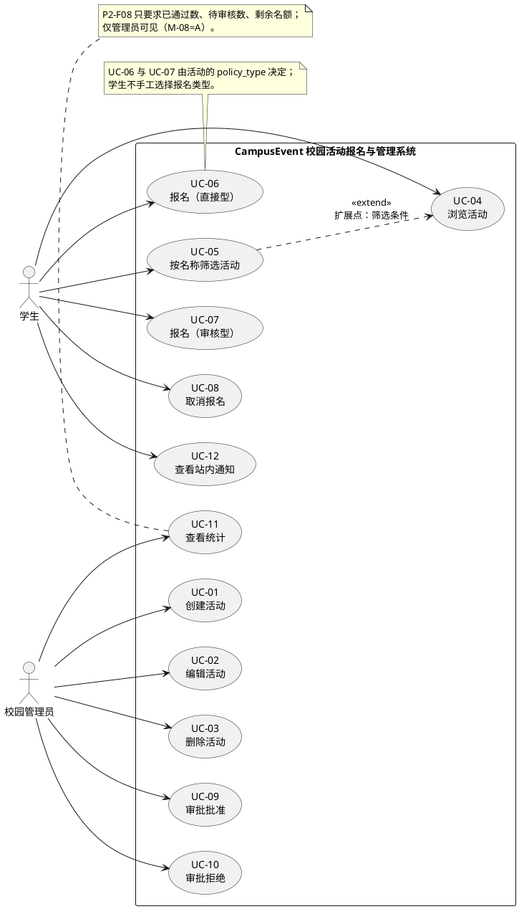

# CampusEvent 用例说明与用例图材料（第2批，依据实验二.docx 修订）

> 状态：第2批已按你的确认收口；等待第3批任务。
>
> **依据**：`实验二.docx`（3.2 P2-F01～F08、3.5 C1～C10、3.3 设计任务 A～D）与 `附录.docx` 附录B（B.1/B.2）。
>
> **决策状态**：`M-01`～`M-08`、`D-01`～`D-10` 已于 2026-11-19 确认；`D-03` 明确为“类型”和“报名方式”两个独立字段。第4～6节已按确认结果落地。若你的本意与某条落地口径不一致，请指出，我按变更处理。
>
> **基线说明**：本会话仍未见第1批的独立确认稿；本文以两份文档与本次确认结果为基线。

---

## 1. 实验二文档已明确的事项（不再提问）

| 事项 | 文档依据 | 已明确的结论 |
|---|---|---|
| 角色与权限 | 实验二 3.2；附录B B.1 | 校园管理员发布/管理活动、审批；学生浏览/报名/取消；固定演示账号，不做注册与复杂权限 |
| 功能范围 | P2-F01～P2-F08 | 活动管理、活动查看、报名/取消、报名策略、审批、状态管理、站内通知、统计 |
| 活动字段 | 附录B B.1；P2-F01 | `activity_id、title、category、start_at、location、capacity、policy_type` |
| 报名状态 | 附录B B.1/B.2；P2-F06 | 待审核、已通过、已拒绝、已取消 |
| 名额口径 | 附录B B.2-3；C4、C8 | 只统计“已通过”；待审核不占名额；批准时二次检查 |
| 重复报名 | 附录B B.2-4；C3 | 同一学生同一活动不得有两条“待审核/已通过”有效报名 |
| 报名方式 | P2-F04；C1、C5 | 直接报名自动通过；审核型进入待审核 |
| 站内通知 | P2-F07；C2、C6、C7 | 报名结果/审核结果写入站内消息列表；直接通过、批准、拒绝均要求通知 |
| 统计指标 | P2-F08；C9 | 按活动查看已通过数、待审核数、剩余名额；取消后统计同步变化 |
| 验收用例 | 实验二 3.5 | C1～C10 已给出；本文只引用，不新增或推测 |
| 设计任务 | 实验二 3.3 | 类图、策略模式、通知解耦、AI 生成设计材料并由其他学生评审签名 |
| 变更阶段 | 实验二 3.6 | 教师统一发布 CR 后再做；本轮不涉及 |
| 部署 | 实验二 3.8 | 最终需部署云服务器；本轮不涉及技术栈与部署方式 |

### 1.1 由文档带来的关键澄清

1. **“类型”与“报名方式”是两个字段**：P2-F01 要求设置“类型”和“报名方式”，对应 B.1 的 `category` 与 `policy_type`；不能把活动类别当成报名策略。
2. **统计指标是固定的三项**：P2-F08 只要求“已通过数、待审核数、剩余名额”，不扩展成大屏指标（M-08=A/D-10）。
3. **通知的明确要求是最小集**：C2（直接通过）、C6（批准）、C7（拒绝）明确要求通知；C5（提交待审核）和 C9（取消）只描述状态变化，未明确要求通知；已按 M-06=A 采用最小集。
4. **C8 说明“满员”与“待审核”可以共存**：批准时容量已满则批准失败；已按 M-04=A 决定“满员时允许提交待审核，并提示批准可能失败”。
5. **C4 确认容量检查发生在直接报名**：容量 2 时 A、B 通过，C 因名额不足失败。

---

## 2. 需求编号与追踪

### 2.1 官方功能编号

| 编号 | 功能模块 | 初始版本要求 |
|---|---|---|
| P2-F01 | 活动管理 | 管理员创建、编辑、删除活动，设置名称、类型、时间、地点、人数上限及报名方式 |
| P2-F02 | 活动查看 | 学生浏览活动列表和活动详情，可按名称筛选 |
| P2-F03 | 报名/取消 | 学生报名、取消；禁止同一活动出现重复有效报名 |
| P2-F04 | 报名策略 | 直接报名自动通过；审核型报名进入待审核状态 |
| P2-F05 | 审批操作 | 管理员批准或拒绝待审核申请，批准时再次检查名额 |
| P2-F06 | 状态管理 | 待审核、已通过、已拒绝、已取消；状态转换符合规则 |
| P2-F07 | 站内通知 | 报名结果及审核结果写入站内消息列表 |
| P2-F08 | 统计 | 按活动查看已通过数、待审核数和剩余名额 |

### 2.2 用例清单与追踪

| 编号 | 用例名称 | 主参与者 | 目标 | 关联需求 | 关联验收用例 | 优先级（暂定） |
|---|---|---|---|---|---|---|
| UC-01 | 创建活动 | 校园管理员 | 建立可供浏览和报名的活动 | P2-F01 | C1 | 高 |
| UC-02 | 编辑活动 | 校园管理员 | 修正活动信息且不破坏已有报名一致性 | P2-F01 | — | 高 |
| UC-03 | 删除活动 | 校园管理员 | 移除不再使用的活动并保留必要历史 | P2-F01；B.2-7 | — | 高 |
| UC-04 | 浏览活动 | 学生 | 了解活动信息、名额与报名策略 | P2-F02 | C1、C2 | 高 |
| UC-05 | 按名称筛选活动 | 学生 | 快速定位名称匹配的活动 | P2-F02 | — | 中 |
| UC-06 | 报名（直接型） | 学生 | 名额充足时立即获得“已通过”报名 | P2-F03、P2-F04；B.2-1/3/4/5 | C2、C3、C4 | 高 |
| UC-07 | 报名（审核型） | 学生 | 提交报名申请进入待审核队列 | P2-F03、P2-F04；B.2-2/3/4/5 | C5 | 高 |
| UC-08 | 取消报名 | 学生 | 撤销本人报名并释放名额 | P2-F03、P2-F06；B.2-5 | C9 | 高 |
| UC-09 | 审批批准 | 校园管理员 | 将符合条件的待审核报名转为已通过 | P2-F05；B.2-2/3 | C6、C8 | 高 |
| UC-10 | 审批拒绝 | 校园管理员 | 明确拒绝待审核报名并告知学生 | P2-F05；B.2-2 | C7 | 高 |
| UC-11 | 查看统计 | 校园管理员 | 了解活动报名与名额使用情况 | P2-F08；B.2-3 | C9 | 中 |
| UC-12 | 查看站内通知 | 学生 | 查看与本人报名/审批相关的消息 | P2-F07；B.1 Message | C2、C6、C7 | 中 |

### 2.3 验收用例覆盖追踪（只引用 C1～C10）

| 验收用例 | 场景摘要 | 覆盖用例 | 备注 |
|---|---|---|---|
| C1 | 管理员创建直接报名活动，容量 2 | UC-01、UC-04 | 创建成功后可被浏览 |
| C2 | 学生 A 报名直接报名活动 | UC-06、UC-12 | 变为已通过并通知 |
| C3 | 学生 A 再次提交相同活动报名 | UC-06 | 拒绝重复有效报名 |
| C4 | B 报名后名额已满，C 再报名 | UC-06 | C 因名额不足失败 |
| C5 | 创建审核型活动，A 申请 | UC-07 | 状态为待审核 |
| C6 | 管理员批准 A 的待审核报名 | UC-09、UC-12 | 变为已通过并通知 |
| C7 | 管理员拒绝另一待审核报名 | UC-10、UC-12 | 变为已拒绝并通知 |
| C8 | 批准操作时容量已满 | UC-09 | 批准失败，不超容量 |
| C9 | 学生取消待审核或已通过报名 | UC-08、UC-11 | 状态已取消，统计同步 |
| C10 | 重启服务后查询活动、报名、通知 | 跨用例（持久化） | 数据仍一致 |

---

## 3. 用例图

### 3.1 PlantUML 源码

文件：`docs/diagrams/use-case.puml`

### 3.2 关系说明

- **UC-05 → UC-04 为 `<<extend>>`**：筛选是浏览列表时的可选增强，扩展点为“活动列表的筛选条件”。若你认为筛选是浏览的必备子流程，可改为 `<<include>>`；这会改变语义，需你确认。
- **UC-06 与 UC-07 保持独立**：二者是同一业务目标“报名”的两种策略分支；策略由活动 `policy_type` 决定，学生不手工选择。
- **UC-09 与 UC-10 分开**：批准涉及名额二次检查，拒绝不涉及；分开后异常流更清晰。
- **管理员不关联 UC-04/06/07/08/12**：按 P2-F01/F03 的职责分离，管理员只做活动管理与审批；管理员不参与学生报名（D-08）。

---

## 4. 用例详细说明

### UC-01 创建活动

| 项 | 内容 |
|---|---|
| 用例编号/名称 | UC-01 创建活动 |
| 触发者/触发事件 | 校园管理员；在活动管理页点击“新建活动”并提交表单 |
| 目标 | 建立一条可供学生浏览和报名的活动记录 |
| 前置条件 | 管理员已使用固定演示账号进入管理端；活动字段定义已加载 |
| 主流程 | 1. 管理员填写标题、类型、开始时间、地点、人数上限、报名方式（直接型/审核型）。 2. 系统校验必填项、容量为正整数、开始时间格式合法。 3. 系统创建活动并持久化，生成 `activity_id`。 4. 系统返回创建成功，管理列表出现新活动。 |
| 异常/边界 | **2a** 必填缺失/容量≤0/时间格式非法：拒绝保存，提示具体字段，保留已填内容。 **2b** 开始时间早于当前时间：拒绝创建并提示（D-01 创建即发布；已开始活动不再接受报名，创建过去活动无业务意义）。 **2c** 标题重复：附录B 未要求唯一，允许。 **3a** 持久化失败：提示创建失败，不产生半条记录。 |
| 后置条件 | 活动记录存在且可被学生浏览；此时无报名记录。 |
| 关联需求 | P2-F01 |
| 关联验收用例 | C1 |

### UC-02 编辑活动

| 项 | 内容 |
|---|---|
| 用例编号/名称 | UC-02 编辑活动 |
| 触发者/触发事件 | 校园管理员；在管理列表选择活动点击“编辑”并保存 |
| 目标 | 修正活动信息，且不破坏已有报名的一致性 |
| 前置条件 | 活动存在；管理员已进入编辑页 |
| 主流程 | 1. 系统加载活动现有字段。 2. 管理员修改允许编辑的字段并提交。 3. 系统校验字段合法性及与已有报名的一致性。 4. 系统保存，列表与详情展示一致。 |
| 异常/边界 | **1a** 活动不存在/已删除：提示并返回列表。 **3a** 容量下调至低于当前“已通过”人数：拒绝（M-02=A）。 **3b** 已有报名时修改 `policy_type`：拒绝（M-02=A）。 **3c** 修改 `start_at` 至过去：拒绝（M-02=A）。 **3d** 并发编辑：提示“数据已变更，请刷新”，以条件更新/版本号避免覆盖（D-09）。 |
| 后置条件 | 活动字段更新；已有报名状态与历史不变。 |
| 关联需求 | P2-F01 |
| 关联验收用例 | — |

### UC-03 删除活动

| 项 | 内容 |
|---|---|
| 用例编号/名称 | UC-03 删除活动 |
| 触发者/触发事件 | 校园管理员；在管理列表选择活动点击“删除”并确认 |
| 目标 | 移除不再使用的活动，同时保留必要历史 |
| 前置条件 | 活动存在；管理员有删除权限 |
| 主流程 | 1. 系统检查该活动是否存在报名记录（任意状态）。 2. 无报名：二次确认后物理删除，列表移除。 3. 有报名：若存在“待审核”报名，拒绝软删除并提示先处理；否则执行软删除，从学生列表隐藏，保留报名与通知历史。 |
| 异常/边界 | **1a** 检查失败：中止删除，提示重试。 **2a** 用户取消确认：不删除。 **3a** 存在待审核报名：拒绝软删除，提示管理员先批准/拒绝（M-01=B 的安全约束）。 **3b** 软删除成功：活动标记删除；历史报名与通知仍可追溯；学生列表不再展示；管理列表默认隐藏（M-01=B）。 **3c** 删除与报名并发：以事务/条件更新避免“活动已删但报名仍创建”的孤儿数据（D-09）。 |
| 后置条件 | 无报名活动被物理删除；有报名活动被软删除；历史不丢失；统计默认排除软删除活动。 |
| 关联需求 | P2-F01；附录B B.2-7 |
| 关联验收用例 | — |

### UC-04 浏览活动

| 项 | 内容 |
|---|---|
| 用例编号/名称 | UC-04 浏览活动 |
| 触发者/触发事件 | 学生；进入活动列表或打开活动详情 |
| 目标 | 了解活动信息、名额与报名策略，决定是否报名 |
| 前置条件 | 学生已登录；系统存在活动数据（可为空） |
| 主流程 | 1. 学生进入活动列表。 2. 系统展示标题、类型、开始时间、地点、人数上限、已通过人数、剩余名额、报名方式、可报名状态。 3. 学生打开某活动详情，查看完整信息。 4. 详情在满足条件时提供报名入口；不满足时说明原因。 |
| 异常/边界 | **1a** 无活动：显示空态提示。 **2a** 已开始：展示活动，但报名入口禁用（M-03=C）。 **2b** 已满：显示“满员”；直接型不可报名；审核型允许提交待审核并提示“批准可能失败”（M-04=A）。 **2c** 软删除活动：学生列表不展示；历史报名/通知中的入口置灰并提示活动已删除（M-01=B）。 **2d** 排序：按 `start_at` 升序，已结束活动置底/可折叠（D-07）。 |
| 后置条件 | 只读，无数据变更。 |
| 关联需求 | P2-F02 |
| 关联验收用例 | C1、C2 |

### UC-05 按名称筛选活动

| 项 | 内容 |
|---|---|
| 用例编号/名称 | UC-05 按名称筛选活动 |
| 触发者/触发事件 | 学生；在活动列表输入名称关键词并执行筛选 |
| 目标 | 快速定位名称匹配的活动 |
| 前置条件 | 学生已进入活动列表 |
| 主流程 | 1. 学生输入名称关键词。 2. 系统按约定的匹配规则过滤活动。 3. 系统展示匹配结果与结果数量。 4. 学生清空关键词，恢复完整列表。 |
| 异常/边界 | **1a** 关键词为空/仅空格：视为不过滤，返回全量。 **2a** 无匹配：显示空态，保留关键词。 **2b** 大小写、前后空格、中文子串：按 D-04 去首尾空格、不区分大小写、子串匹配。 **2c** 与其他条件组合：P2-F02 只要求名称；查询接口预留组合条件，不在本批实现。 |
| 后置条件 | 只读，无数据变更。 |
| 关联需求 | P2-F02 |
| 关联验收用例 | — |

### UC-06 报名（直接型）

| 项 | 内容 |
|---|---|
| 用例编号/名称 | UC-06 报名（直接型） |
| 触发者/触发事件 | 学生；在直接型活动详情点击“报名” |
| 目标 | 在名额充足且无冲突时立即获得“已通过”报名 |
| 前置条件 | 学生已登录；活动存在且未软删除；`policy_type=直接型`；当前时间早于 `start_at`；学生对该活动无“待审核/已通过”记录；已通过人数小于 `capacity` |
| 主流程 | 1. 学生点击报名。 2. 系统校验活动存在、未开始、无重复有效报名、名额充足。 3. 系统创建报名记录，`status=已通过`，写入 `created_at/updated_at`。 4. 系统在同一事务写入报名事件/outbox；由派发器异步创建“报名成功”站内通知（M-07=B）。 5. 系统返回报名成功，刷新剩余名额。 |
| 异常/边界 | **2a** 活动不存在/已软删除/已开始：拒绝，提示不可报名（B.2-5）。 **2b** 已有“待审核/已通过”：拒绝重复报名；已拒绝/已取消允许新建记录（B.2-4）。 **2c** 名额已满：拒绝，提示满员（B.2-3；C4）。 **2d** 并发争抢最后名额：仅一个成功，其余提示满员（D-09）。 **2e** 重复点击/重复提交：返回已有有效报名或幂等提示，不产生两条有效记录（D-09）。 **4a** 通知派发失败：报名保留，事件保持待重试/失败状态并留痕，不回滚报名（B.2-6；M-07=B）。 |
| 后置条件 | 一条“已通过”报名；名额占用 +1；报名事件已落库，通知成功或失败留痕。 |
| 关联需求 | P2-F03、P2-F04；B.2-1/3/4/5 |
| 关联验收用例 | C2、C3、C4 |

### UC-07 报名（审核型）

| 项 | 内容 |
|---|---|
| 用例编号/名称 | UC-07 报名（审核型） |
| 触发者/触发事件 | 学生；在审核型活动详情点击“报名” |
| 目标 | 提交报名申请，进入待审核队列 |
| 前置条件 | 学生已登录；活动存在且未软删除；`policy_type=审核型`；当前时间早于 `start_at`；学生对该活动无“待审核/已通过”记录 |
| 主流程 | 1. 学生点击报名。 2. 系统校验活动存在、未开始、无重复有效报名。 3. 系统创建报名记录，`status=待审核`，写入 `created_at/updated_at`。 4. 按 M-06=A，不创建“提交待审核”通知；仅记录报名。 5. 系统返回提交成功；名额不变。 |
| 异常/边界 | **2a** 活动不存在/已软删除/已开始：拒绝（B.2-5）。 **2b** 已有“待审核/已通过”：拒绝重复；已拒绝/已取消允许新建（B.2-4）。 **2c** 名额已满：允许提交待审核，但提示“已满员，批准可能失败”（M-04=A）。 **2d** 重复提交：幂等，不产生两条“待审核”（D-09）。 |
| 后置条件 | 一条“待审核”报名；不占名额；不产生通知（M-06=A）。 |
| 关联需求 | P2-F03、P2-F04；B.2-2/3/4/5 |
| 关联验收用例 | C5 |

### UC-08 取消报名

| 项 | 内容 |
|---|---|
| 用例编号/名称 | UC-08 取消报名 |
| 触发者/触发事件 | 学生；在活动详情或“我的报名”中点击“取消报名”并确认 |
| 目标 | 撤销本人报名，释放名额（如已通过） |
| 前置条件 | 学生已登录；存在本人该活动的“待审核”或“已通过”报名；活动开始后仍允许取消（M-03=C） |
| 主流程 | 1. 学生选择要取消的报名。 2. 系统校验报名归属与当前状态。 3. 系统要求二次确认。 4. 系统将状态改为已取消，更新 `updated_at`。 5. 若原状态为已通过，释放名额；按 M-06=A，不创建“已取消”通知。 |
| 异常/边界 | **2a** 非本人报名：拒绝，提示无权操作。 **2b** 状态为已拒绝/已取消：提示当前状态不可取消。 **2c** 活动已开始：允许取消（M-03=C）；若原为已通过，仍释放名额并同步统计。 **4a** 与审批并发：以条件更新为准；若审批已先成功，取消仍可执行（D-09）。 |
| 后置条件 | 报名=已取消；名额释放（若原已通过）；历史保留；可重新申请；不产生通知（M-06=A）。 |
| 关联需求 | P2-F03、P2-F06；B.2-5 |
| 关联验收用例 | C9 |

### UC-09 审批批准

| 项 | 内容 |
|---|---|
| 用例编号/名称 | UC-09 审批批准 |
| 触发者/触发事件 | 校园管理员；在待审核列表选择报名点击“批准” |
| 目标 | 将符合条件的待审核报名转为已通过 |
| 前置条件 | 管理员已登录；报名存在且为“待审核”；活动存在、未软删除且未开始（M-03=C 禁止开始后批准） |
| 主流程 | 1. 管理员打开待审核列表或活动报名列表。 2. 管理员选择一条待审核报名，点击批准。 3. 系统重新统计该活动“已通过”人数，检查剩余名额（二次检查）。 4. 名额充足：状态改为已通过，更新 `updated_at`；写入报名事件/outbox，由派发器异步通知学生“报名已通过”（M-07=B）。 5. 系统返回批准成功，刷新名额。 |
| 异常/边界 | **1a** 报名不存在/状态已变更：提示刷新，不重复处理。 **3a** 名额不足：保持待审核并提示管理员（M-05=A）；不得超容量批准（C8）。 **3b** 活动已开始：拒绝批准（M-03=C）。 **3c** 两个管理员并发批准最后一个名额：仅一个成功，另一个提示名额已满（D-09）。 **4a** 通知派发失败：审批结果保留，事件待重试/失败留痕（M-07=B）。 |
| 后置条件 | 报名=已通过；名额 +1；报名事件已落库，通知成功或失败留痕。 |
| 关联需求 | P2-F05；B.2-2/3 |
| 关联验收用例 | C6、C8 |

### UC-10 审批拒绝

| 项 | 内容 |
|---|---|
| 用例编号/名称 | UC-10 审批拒绝 |
| 触发者/触发事件 | 校园管理员；在待审核列表选择报名点击“拒绝” |
| 目标 | 明确拒绝一条待审核报名并告知学生 |
| 前置条件 | 管理员已登录；报名存在且为“待审核”；活动开始后仍允许拒绝以清理队列（M-03=C 的落地解释） |
| 主流程 | 1. 管理员选择待审核报名，点击拒绝。 2. 管理员填写拒绝理由（选填，D-05）。 3. 系统将状态改为已拒绝，更新 `updated_at`。 4. 系统写入报名事件/outbox，由派发器异步通知学生“报名未通过”及理由（M-07=B）。 |
| 异常/边界 | **1a** 报名不存在/状态已变更：提示刷新，不重复处理。 **1b** 状态为已拒绝/已通过/已取消：不允许再次拒绝。 **4a** 通知派发失败：状态保留，事件待重试/失败留痕（M-07=B）。 **4b** 拒绝后重新申请：允许立即重新申请，不设次数/冷却（D-05）。 |
| 后置条件 | 报名=已拒绝；不占名额；历史保留；可立即重新申请；报名事件已落库。 |
| 关联需求 | P2-F05；B.2-2 |
| 关联验收用例 | C7 |

### UC-11 查看统计

| 项 | 内容 |
|---|---|
| 用例编号/名称 | UC-11 查看统计 |
| 触发者/触发事件 | 校园管理员；进入统计页（M-08=A：仅管理员） |
| 目标 | 了解活动报名与名额使用情况 |
| 前置条件 | 管理员已登录；统计范围为全量活动（软删除活动默认排除） |
| 主流程 | 1. 管理员进入统计页。 2. 系统按活动展示 P2-F08 要求的三项：已通过数、待审核数、剩余名额。 3. 系统展示活动维度的汇总。 |
| 异常/边界 | **1a** 无活动/无报名：显示 0，不报错。 **2a** 软删除活动：默认排除（M-01=B/M-08=A）。 **2b** 统计口径：仅“已通过”占名额；待审核不占；剩余名额=`capacity`-已通过数。 **2c** 严格展示 P2-F08 三项；不增加拒绝数、取消数、满员率（M-08=A/D-10）。 |
| 后置条件 | 只读，无数据变更。 |
| 关联需求 | P2-F08；B.2-3 |
| 关联验收用例 | C9 |

### UC-12 查看站内通知

| 项 | 内容 |
|---|---|
| 用例编号/名称 | UC-12 查看站内通知 |
| 触发者/触发事件 | 学生；进入通知列表或点击通知 |
| 目标 | 查看与本人报名/审批相关的消息 |
| 前置条件 | 学生已登录 |
| 主流程 | 1. 学生进入通知列表。 2. 系统按 `created_at` 倒序展示本人通知：内容、关联活动、时间、已读状态；通知来源仅限直接通过、批准、拒绝（M-06=A）。 3. 学生打开通知查看详情；系统按约定规则标记已读。 |
| 异常/边界 | **1a** 无通知：显示空态。 **2a** 关联活动已删除/软删除：通知仍显示，活动入口置灰或提示不可用。 **2b** 越权查看他人通知：拒绝。 **3a** 已读规则：点击详情才标记已读；列表显示未读数（D-06）。 **3b** 通知失败记录：不在学生通知列表展示；失败事件在 outbox/日志留痕，供运维排查（M-07=B）。 |
| 后置条件 | `is_read` 可能变更；无业务数据变更。 |
| 关联需求 | P2-F07；B.1 Message |
| 关联验收用例 | C2、C6、C7 |

---

## 5. 关键边界与状态规则

### 5.1 报名状态转换（用例视角）

| 当前状态 | 事件 | 下一状态 | 条件/说明 |
|---|---|---|---|
| 无记录 | 直接型报名 | 已通过 | 活动未开始、无重复有效报名、名额充足 |
| 无记录 | 审核型报名 | 待审核 | 活动未开始、无重复有效报名 |
| 待审核 | 管理员批准 | 已通过 | 二次检查名额充足；活动未开始（M-03=C） |
| 待审核 | 管理员拒绝 | 已拒绝 | 管理员显式操作；活动开始后仍允许，用于清理队列（M-03=C 落地解释） |
| 待审核 | 学生取消 | 已取消 | 本人操作；开始后仍允许（M-03=C） |
| 已通过 | 学生取消 | 已取消 | 本人操作；开始后仍允许（M-03=C） |
| 待审核 | 活动开始 | 待审核 | 不自动转换；可由管理员拒绝或学生取消 |
| 已拒绝 | — | 终态 | 重新申请会产生新记录，不复活旧记录 |
| 已取消 | — | 终态 | 重新申请会产生新记录，不复活旧记录 |

> 本表是业务状态规则，不是 UML 状态图；状态图留待后续批次。

### 5.2 重复有效报名

- **有效报名定义**：同一 `student_id` + `activity_id`，状态为“待审核”或“已通过”。
- **上限**：最多一条。
- **历史记录**：“已拒绝”“已取消”保留，不阻止再次申请；再次申请创建新记录，不修改旧记录。
- **检查点**：直接报名创建前、审核报名创建前。
- **文档依据**：B.2-4、C3。
- **并发边界**：双击、两个标签页同时提交、请求重试，都不能产生两条有效记录（D-09）。

### 5.3 名额检查

- **占用口径**：`count(status=已通过)`；待审核、已拒绝、已取消都不占名额。
- **检查点**：
  1. 直接型报名创建前（C4）；
  2. 审核型报名批准时二次检查（C8）；
  3. 已通过报名取消后释放名额（C9）。
- **剩余名额**：`capacity - count(已通过)`。
- **满员处理**：直接型拒绝；审核型提交允许并提示（M-04=A）；批准保持待审核（M-05=A）。
- **并发边界**：最后名额必须原子检查，不能出现“两个都批准成功”或“批准后超过容量”（D-09）。

### 5.4 通知触发矩阵（已确认）

| 事件 | 接收人 | 文档是否明确要求 | 依据 | 当前处理 |
|---|---|---|---|---|
| 直接型报名成功 | 学生 | 是 | C2、P2-F07 | 创建通知（经 outbox） |
| 审核型报名提交 | 学生 | 否 | C5 只要求状态为待审核 | 不创建通知（M-06=A） |
| 审批批准 | 学生 | 是 | C6、P2-F07 | 创建通知（经 outbox） |
| 审批拒绝 | 学生 | 是 | C7、P2-F07 | 创建通知（经 outbox） |
| 学生取消报名 | 学生 | 否 | C9 只要求状态与统计 | 不创建通知（M-06=A） |
| 新待审核报名 | 管理员 | 否 | `Message.student_id` 指向学生 | 不创建；管理员用待审核列表 |

> **重复通知控制（M-07=B）**：报名/审批事件写入同库 outbox 表，事件带唯一键；派发器按事件幂等消费，Message 侧再加唯一约束，避免重复写消息。使用 outbox + 观察者。

### 5.5 统计口径（P2-F08）

- 仅管理员可见（M-08=A）。
- 按活动展示三项：**已通过数、待审核数、剩余名额**。
- 剩余名额 = `capacity` - 已通过数；待审核不占名额。
- 取消后统计同步变化（C9）：
  - 取消“待审核”：待审核数 -1；
  - 取消“已通过”：已通过数 -1，剩余名额 +1。
- 严格只展示三项；不扩展拒绝数、取消数、满员率（M-08=A/D-10）。
- 软删除活动默认排除（M-01=B/M-08=A）。

---

## 6. 已确认决策记录

> 确认日期：2026-11-19。`D-03` 由你明确为两个字段；其余 `M`/`D` 项按本表落地。若后续需要修改，走变更阶段并记录影响。

### 6.1 关键决策（M-01～M-08）

| 编号 | 决策 | 落地口径 | 主要影响 |
|---|---|---|---|
| M-01 | **软删除** | 有报名的活动不物理删除；标记 `deleted_at`/`is_deleted`；学生列表不展示；历史报名/通知保留；统计默认排除；管理列表默认隐藏，恢复功能不纳入初始版本；**存在“待审核”报名时拒绝软删除**，先清理队列 | UC-03/04/11/12；所有活动查询需过滤删除标记 |
| M-02 | **严格编辑约束** | 容量不得低于已通过数；有报名后 `policy_type` 不可改；`start_at` 不得早于当前；并发用条件更新/版本号 | UC-02/06/07/09 |
| M-03 | **禁止开始后批准，允许拒绝与取消** | 活动开始后不新增“已通过”；管理员可拒绝待审核以清理队列；学生可取消待审核/已通过；不自动转换状态 | UC-04/08/09/10 |
| M-04 | **满员允许提交审核型待审核** | 提交时提示“已满员，批准可能失败”；待审核不占名额 | UC-07/09 |
| M-05 | **批准时名额不足保持待审核** | 不自动拒绝；提示管理员；不得超容量批准（C8） | UC-09/10/11 |
| M-06 | **最小通知集** | 只对直接通过、批准、拒绝写站内消息；审核提交、取消不写消息 | UC-06/07/08/09/10/12 |
| M-07 | **同库 outbox/事件表** | 主业务事务写报名/审批结果 + 事件；派发器异步写 Message；事件唯一键 + 消费幂等防重复；失败重试/留痕；不回滚主业务 | UC-06/07/08/09/10/12 |
| M-08 | **统计仅管理员、严格三项** | 已通过数、待审核数、剩余名额；软删除活动排除；不扩展指标 | UC-11 |

> **M-03 的落地解释**：把“禁止审批”落地为“禁止批准”（不再新增已通过），但保留“拒绝”用于清理开始后仍滞留的待审核。若你的本意是连“拒绝”也禁止，请指出，我改为严格禁止。

### 6.2 默认项（D-01～D-10，已确认）

| 编号 | 已确认值 | 依据 |
|---|---|---|
| D-01 | 活动创建即发布，使用创建即发布 | P2-F01 只要求创建、编辑、删除；B.1 无活动状态字段 |
| D-02 | 时间字段只有 `start_at`；报名截止即活动开始 | B.1 Activity；B.2-5 |
| D-03 | **两个独立字段**：“类型”=`category` 自由文本；“报名方式”=`policy_type` 仅直接型/审核型两值 | P2-F01、P2-F04；B.1；你的明确确认 |
| D-04 | 名称筛选：去首尾空格、不区分大小写、子串匹配；空关键词不过滤 | P2-F02 |
| D-05 | 拒绝理由选填；拒绝/取消后可立即重新申请，不设次数/冷却 | B.2-4；P2-F05 |
| D-06 | 点击通知详情才标记已读；列表显示未读数 | B.1 `is_read` |
| D-07 | 活动列表按 `start_at` 升序；已结束活动置底/可折叠；本批不做状态筛选 | P2-F02 |
| D-08 | 管理员不参与学生报名；可浏览活动用于管理 | P2-F01/F03 的职责分离 |
| D-09 | 并发：DB 唯一约束（活动+学生+有效状态）+ 条件更新 + 事务；重复提交返回已有记录 | C3、C4、C8 |
| D-10 | 统计只展示 P2-F08 三项，不扩展拒绝/取消数、满员率 | P2-F08 |

### 6.3 由决策推出的补充规则

- 创建活动时 `start_at` 早于当前时间：拒绝创建。
- 活动开始后：不新增报名、不批准；可拒绝待审核、可取消报名。
- 软删除活动：学生列表与统计默认排除；历史报名/通知保留；通知中的活动入口置灰。
- 软删除前置检查：存在“待审核”报名时拒绝软删除，管理员需先批准/拒绝，避免待审核记录悬空。
- 通知失败：报名/审批结果不回滚；outbox 事件待重试并留痕。
- 统计只算“已通过”占名额；剩余名额 = 容量 - 已通过数。

---

## 7. 本轮确认结果与后续检查点

- [x] `M-01`～`M-08` 已确认。
- [x] `D-01`～`D-10` 已确认；`D-03` 明确为两个独立字段。
- [x] 用例粒度：创建/编辑/删除分开；直接/审核报名分开；批准/拒绝分开。
- [x] 参与者：学生与校园管理员；固定演示账号；不做注册与复杂权限。
- [x] 报名状态：待审核、已通过、已拒绝、已取消；使用当前四状态范围。
- [x] 通知触发矩阵与统计口径已按确认结果落地。
- [ ] **同行评审签名**：按实验二 3.3 设计任务 D，需其他学生评审用例/类图/时序图/设计原则并签名；待第3批材料齐备后补评审检查表与签名记录。
- [ ] **第3批**：UML 类图、报名与审批时序图（各至少 1 张）、设计原则说明、评审检查表。
- [ ] **后续批次**：技术栈/数据库/部署方式（实验二 3.8 要求云服务器部署），以及教师发布的 CR。
- [ ] 变更阶段不得提前实现；等教师统一发布 Change Request。

---

## 8. 本轮文件变更

| 文件 | 操作 | 说明 |
|---|---|---|
| `实验/CampusEvent/docs/01-use-cases.md` | 新增/修订 | 依据实验二.docx 与本次确认结果修订的用例清单、用例说明、边界规则、决策记录 |
| `实验/CampusEvent/docs/diagrams/use-case.puml` | 新增 | 用例图 PlantUML 源码 |

> 本轮未执行任何 Git 操作；未生成类图、数据库脚本、接口代码或前端页面。

---

## 9. 第2批收口

第2批的开放决策已全部确认并落入本文。下一步等待你发布**第3批任务**（类图/时序图/设计原则/评审检查表）；在你明确进入第3批之前，我不生成类图、接口契约或实现代码。
