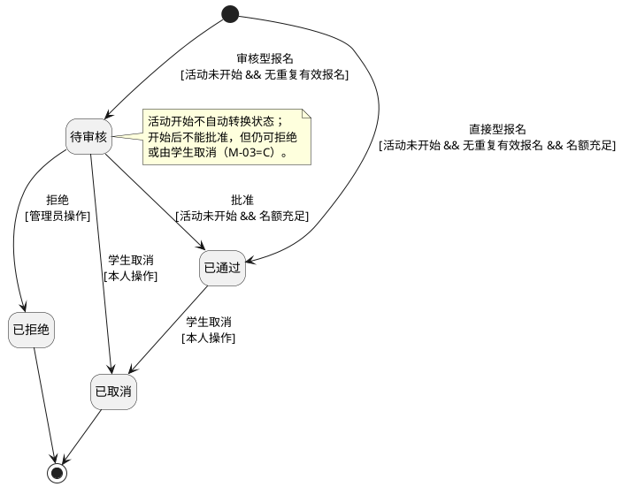

# CampusEvent UML 类图 V1 与职责边界（第3批，D4-01=C / D5-02=C / D6 契约已落地）

> 状态：第3批设计已按第4/5/6批决策更新；等待设计评审。本轮只做设计材料，不含业务代码、数据库脚本、技术栈选型与部署方案。
>
> **依据**：`实验二.docx`（P2-F01～F08、C1～C10、设计任务 A～D）、`附录.docx` 附录B、以及第2批已确认的 `M-01`～`M-08` 与 `D-01`～`D-10`。
>
> **基线说明**：本会话没有第1批的独立确认稿；第8节的遵守情况检查按“第2批锁定规则 + 附录B B.2”逐条核对。若你的第1批确认稿有额外规则，请贴回，我补差。
>
> **D4-01 已确认：本轮 C（公共规则 + 策略只决定初始状态）**。提交时由 `CapacityRule.checkSubmission(...)` 做策略性预检查；批准时由 `CapacityRule.checkApproval(...)` 执行硬不变量。`RegistrationPolicy` 只负责初始状态/审批需求；第3批 C' 的 `preCheck` 已移除。详见第7节。
>
> **D5-02 已确认：C（outbox + 事务后派发）**。事件与业务同事务写入 outbox；派发失败不回滚报名。领域事件 5 个，其中通知 3 个（`REGISTERED/APPROVED/REJECTED`），`SUBMITTED/CANCELLED` 仅审计；`NotificationService` 改为接口 + `InSiteNotificationService`；`Message` 用 `(sourceEventId, studentId)` 幂等。详见 `04-notification-decoupling.md`。
>
> **D6 契约已确认**：`RegistrationRepository` 用 `insert` + `updateStatusIfCurrent`；`OutboxRepository` 增加 `markProcessing`；`studentName` 可选；拒绝/取消标题缺失用兜底。6 张时序图见 `05-sequence-and-contracts.md`。

---

## 1. 设计范围与命名

### 1.1 本轮范围

- 领域对象：`Student`、`Activity`、`Registration`、`Message`，以及状态/类型枚举。
- 应用服务：`ActivityService`、`RegistrationService`、`StatisticsService`、`NotificationService`。
- 策略：`RegistrationPolicy`、`DirectRegistrationPolicy`、`ReviewRegistrationPolicy`、`RegistrationPolicyFactory`。
- 名额公共规则：`CapacityRule`、`DefaultCapacityRule`、`CapacityDecision`。
- 通知解耦：`RegistrationEvent`、`RegistrationEventType`、`ActorRole`、`OutboxEvent`、`OutboxEventPublisher`、`EventDispatcher`、`RegistrationEventObserver`、`NotificationService`、`InSiteNotificationService`、`NotificationType`。
- 持久化端口：`ActivityRepository`、`RegistrationRepository`、`MessageRepository`、`OutboxRepository`。
- 状态机：`Registration` 的合法/非法转换。

### 1.2 类名调整与理由

| 名称 | 是否在实验二建议概念中 | 调整理由 |
|---|---|---|
| `Activity`、`Student`、`Registration`、`RegistrationService`、`RegistrationPolicy` | 是 | 保留原概念，职责按本批边界细化 |
| `NotificationService` | 是 | 保留概念，改为接口；`InSiteNotificationService` 为站内实现 |
| `NotificationType`、`ActorRole` | 否（枚举/值对象） | 消息类型、事件操作者角色；避免字符串魔法值 |
| `ActivityService` | 否（新增） | P2-F01/F02 的活动 CRUD、浏览、名称筛选需要独立入口；不放进 `RegistrationService`，避免报名服务承担活动管理 |
| `DirectRegistrationPolicy`、`ReviewRegistrationPolicy` | 否（策略实现） | 设计任务 B 要求直接报名/审核报名作为不同实现 |
| `RegistrationPolicyFactory` | 否（新增） | 按 `PolicyType` 选择策略，避免 `RegistrationService` 写 `if/else` 类型判断 |
| `CapacityRule`、`DefaultCapacityRule`、`CapacityDecision` | 否（新增） | D4-01=C：名额检查作为公共规则，策略只决定初始状态；规则可独立测试、替换 |
| `RegistrationEvent`、`OutboxEvent`、`OutboxEventPublisher`、`EventDispatcher` | 否（新增） | M-07=B 已确认同库 outbox + 观察者；`RegistrationService` 只依赖事件发布抽象，不直接依赖 `NotificationService` |
| `ActivityStatistics` | 否（新增） | P2-F08 的只读统计结果，避免把统计字段塞进 `Activity` |
| `Message` | 附录B B.1 | 站内消息实体；`sourceEventId` 幂等；`type/title/readAt` 支持展示与已读；唯一键 `(sourceEventId, studentId)` |
| `ActivityRepository` 等仓储接口 | 否（新增） | DIP 与可测试性；技术栈未定，先定义端口，不绑定 ORM/SQL |

> 没有引入 `Admin` 类：管理员是固定演示账号的访问角色，不是附录B 的领域实体；权限校验放在应用入口层，不进入领域模型。

---

## 2. UML 类图 V1

### 2.1 PlantUML 源码

文件：`docs/diagrams/class-diagram-v1.puml`

```plantuml
@startuml
skinparam classAttributeIconSize 0
skinparam packageStyle rectangle
skinparam shadowing false
hide empty members

package "domain" {
  class Student {
    - studentId: String
    - name: String
    + getId(): String
  }

  class Activity {
    - activityId: String
    - title: String
    - category: String
    - startAt: DateTime
    - location: String
    - capacity: int
    - policyType: PolicyType
    - deletedAt: DateTime
    + isDeleted(): boolean
    + hasStarted(now: DateTime): boolean
    + isOpenForRegistration(now: DateTime): boolean
    + canReduceCapacityTo(newCapacity: int, approvedCount: int): boolean
  }

  class Registration {
    - registrationId: String
    - activityId: String
    - studentId: String
    - status: RegistrationStatus
    - createdAt: DateTime
    - updatedAt: DateTime
    + approve(now: DateTime): void
    + reject(now: DateTime): void
    + cancel(now: DateTime): void
    + isActive(): boolean
  }

  enum RegistrationStatus {
    PENDING
    APPROVED
    REJECTED
    CANCELLED
  }

  enum PolicyType {
    DIRECT
    REVIEW
  }

  class Message {
    - messageId: String
    - studentId: String
    - activityId: String
    - sourceEventId: String
    - type: NotificationType
    - title: String
    - content: String
    - createdAt: DateTime
    - isRead: boolean
    - readAt: DateTime
    + markRead(now: DateTime): void
  }

  enum NotificationType {
    REGISTRATION_SUCCESS
    REGISTRATION_APPROVED
    REGISTRATION_REJECTED
  }
}

package "application" {
  class ActivityService {
    - activityRepo: ActivityRepository
    - registrationRepo: RegistrationRepository
    + create(...): Activity
    + update(...): Activity
    + softDelete(activityId: String): void
    + listVisible(keyword: String): Activity[]
    + getDetail(activityId: String): Activity
  }

  class RegistrationService {
    - activityRepo: ActivityRepository
    - registrationRepo: RegistrationRepository
    - policyFactory: RegistrationPolicyFactory
    - capacityRule: CapacityRule
    - eventPublisher: RegistrationEventPublisher
    + register(studentId: String, activityId: String): RegistrationResult
    + cancel(studentId: String, registrationId: String): void
    + approve(registrationId: String): Registration
    + reject(registrationId: String, reason: String): Registration
    + listByStudent(studentId: String): Registration[]
    + listPendingByActivity(activityId: String): Registration[]
  }

  class StatisticsService {
    - activityRepo: ActivityRepository
    - registrationRepo: RegistrationRepository
    + getActivityStatistics(activityId: String): ActivityStatistics
    + getAll(): ActivityStatistics[]
  }

  class ActivityStatistics {
    - activityId: String
    - approvedCount: int
    - pendingCount: int
    - remainingCapacity: int
  }

  class RegistrationResult {
    - registration: Registration
    - warning: String
    + hasWarning(): boolean
    + getWarning(): String
  }

  class CapacityDecision {
    - allowed: boolean
    - warning: boolean
    - message: String
    + isAllowed(): boolean
    + isWarning(): boolean
    + getMessage(): String
  }

  interface CapacityRule {
    + checkSubmission(activity: Activity, approvedCount: int, initialStatus: RegistrationStatus): CapacityDecision
    + checkApproval(activity: Activity, approvedCount: int): CapacityDecision
  }

  class DefaultCapacityRule

  interface RegistrationPolicy {
    + initialStatus(activity: Activity): RegistrationStatus
    + requiresApproval(): boolean
  }

  class DirectRegistrationPolicy
  class ReviewRegistrationPolicy

  class RegistrationPolicyFactory {
    + create(type: PolicyType): RegistrationPolicy
  }
}

package "ports" {
  interface ActivityRepository {
    + findById(id: String): Activity
    + findByIdForUpdate(id: String): Activity
    + save(activity: Activity): void
    + findVisible(keyword: String): Activity[]
  }

  interface RegistrationRepository {
    + findById(id: String): Registration
    + insert(registration: Registration): void
    + updateStatusIfCurrent(id: String, expected: RegistrationStatus, target: RegistrationStatus, now: DateTime): boolean
    + findActiveBy(activityId: String, studentId: String): Registration
    + countApproved(activityId: String): int
    + findPendingByActivity(activityId: String): Registration[]
    + findByStudent(studentId: String): Registration[]
  }

  interface MessageRepository {
    + save(message: Message): void
    + findByStudent(studentId: String): Message[]
    + markRead(messageId: String, studentId: String): void
    + existsBySourceEventId(eventId: String): boolean
    + countUnread(studentId: String): int
  }

  interface OutboxRepository {
    + save(event: OutboxEvent): void
    + findPending(limit: int): OutboxEvent[]
    + markProcessing(eventId: String): boolean
    + markSent(eventId: String): void
    + markFailed(eventId: String, reason: String): void
  }

  interface RegistrationEventPublisher {
    + publish(event: RegistrationEvent): void
  }

  interface RegistrationEventObserver {
    + onEvent(event: RegistrationEvent): void
  }
}

package "notification" {
  class RegistrationEvent {
    - eventId: String
    - schemaVersion: int
    - type: RegistrationEventType
    - registrationId: String
    - activityId: String
    - studentId: String
    - policyType: PolicyType
    - fromStatus: RegistrationStatus
    - toStatus: RegistrationStatus
    - actorId: String
    - actorRole: ActorRole
    - reason: String
    - activityTitle: String
    - studentName: String
    - occurredAt: DateTime
  }

  enum ActorRole {
    STUDENT
    ADMIN
  }

  enum RegistrationEventType {
    REGISTERED
    SUBMITTED
    APPROVED
    REJECTED
    CANCELLED
  }

  class OutboxEvent {
    - eventId: String
    - type: RegistrationEventType
    - payload: String
    - status: OutboxStatus
    - retryCount: int
    - nextAttemptAt: DateTime
    - lastError: String
    - createdAt: DateTime
  }

  enum OutboxStatus {
    PENDING
    PROCESSING
    SENT
    FAILED
  }

  class OutboxEventPublisher {
    - outboxRepo: OutboxRepository
    + publish(event: RegistrationEvent): void
  }

  class EventDispatcher {
    - outboxRepo: OutboxRepository
    - observers: RegistrationEventObserver[]
    + dispatchPending(): void
  }

  interface NotificationService {
    + onEvent(event: RegistrationEvent): void
    + listByStudent(studentId: String): Message[]
    + markRead(messageId: String, studentId: String): void
    + unreadCount(studentId: String): int
  }

  class InSiteNotificationService {
    - messageRepo: MessageRepository
    + onEvent(event: RegistrationEvent): void
    + listByStudent(studentId: String): Message[]
    + markRead(messageId: String, studentId: String): void
    + unreadCount(studentId: String): int
  }
}

' ---------- domain associations ----------
Student "1" -- "0..*" Registration : submits
Activity "1" -- "0..*" Registration : relates
Student "1" -- "0..*" Message : receives
Activity "1" -- "0..*" Message : relates

Registration --> RegistrationStatus
Activity --> PolicyType

' ---------- application dependencies ----------
ActivityService --> ActivityRepository
ActivityService --> RegistrationRepository
RegistrationService --> ActivityRepository
RegistrationService --> RegistrationRepository
RegistrationService --> RegistrationPolicyFactory
RegistrationService --> CapacityRule
RegistrationService --> RegistrationEventPublisher
RegistrationService ..> Registration : creates/loads
RegistrationService ..> Activity : reads
RegistrationService ..> RegistrationResult
RegistrationService ..> CapacityDecision

StatisticsService --> ActivityRepository
StatisticsService --> RegistrationRepository
StatisticsService ..> ActivityStatistics

RegistrationPolicyFactory ..> RegistrationPolicy
CapacityRule ..> CapacityDecision
CapacityRule <|.. DefaultCapacityRule
RegistrationPolicy <|.. DirectRegistrationPolicy
RegistrationPolicy <|.. ReviewRegistrationPolicy

' ---------- notification / outbox ----------
OutboxEventPublisher ..|> RegistrationEventPublisher
OutboxEventPublisher --> OutboxRepository
EventDispatcher --> OutboxRepository
EventDispatcher --> RegistrationEventObserver
NotificationService --|> RegistrationEventObserver
NotificationService <|.. InSiteNotificationService
InSiteNotificationService --> MessageRepository

RegistrationEventPublisher ..> RegistrationEvent
RegistrationEventObserver ..> RegistrationEvent
NotificationService ..> RegistrationEvent
NotificationService ..> Message
InSiteNotificationService ..> Message : creates
OutboxEvent ..> RegistrationEvent : serialized payload

Message --> NotificationType
RegistrationEvent --> PolicyType
RegistrationEvent --> RegistrationStatus
RegistrationEvent --> ActorRole

' ---------- notes ----------
note right of RegistrationService
  D4-01 = C (public rule + minimal policy):
  submit -> capacityRule.checkSubmission(...)
  approve -> capacityRule.checkApproval(...)
  Service owns the transaction; the rule is pure.
end note

note bottom of CapacityRule
  checkSubmission uses initialStatus:
  APPROVED + full -> reject;
  PENDING + full -> allow with warning (M-04=A).
  checkApproval is the hard invariant (C8/M-05=A).
end note

note bottom of RegistrationPolicy
  Policy only decides initial status / approval requirement.
  It does not check capacity (D4-01=C).
end note

note bottom of CapacityDecision
  allowed=false -> reject submission/approval;
  allowed=true + warning=true -> allow with message.
end note

note bottom of Registration
  Status transitions are guarded by entity methods;
  illegal transitions raise a domain exception.
end note

note bottom of Activity
  Soft-deleted activities are hidden from student lists and statistics.
  Soft delete is rejected while PENDING registrations exist.
end note

note bottom of Student
  Associations are conceptual; entities reference each other by ID,
  not by object navigation.
end note

note bottom of Message
  sourceEventId is an internal dedup key;
  unique (sourceEventId, studentId).
  readAt is set when the student opens the message.
end note

note bottom of NotificationService
  Handles only REGISTERED / APPROVED / REJECTED.
  SUBMITTED / CANCELLED are skipped (M-06=A).
end note

note bottom of RegistrationEvent
  fromStatus and reason may be null.
  activityTitle is a snapshot; studentName is optional
  (current templates use "你").
end note

note bottom of OutboxEvent
  payload serializes RegistrationEvent.
  eventId is unique; status: PENDING -> PROCESSING -> SENT/FAILED.
end note

note bottom of OutboxEventPublisher
  Writes the outbox row in the same transaction as the registration.
  No message queue is used.
end note

note bottom of RegistrationStatus
  PENDING=待审核, APPROVED=已通过,
  REJECTED=已拒绝, CANCELLED=已取消
end note

note bottom of PolicyType
  DIRECT=直接型, REVIEW=审核型
end note

@enduml
```

### 2.2 阅读说明

- **实线**：关联/依赖；**虚线**：依赖或实现（`..|>` 为实现）。
- **实体之间只存 ID**：`Registration.activityId/studentId`、`Message.studentId/activityId` 都是 ID 引用；图中的关联表示领域关系，不表示对象导航或级联加载。
- **枚举值用英文常量**：`PENDING/APPROVED/REJECTED/CANCELLED`、`DIRECT/REVIEW`、`REGISTERED/SUBMITTED/APPROVED/REJECTED/CANCELLED`、`STUDENT/ADMIN`、`REGISTRATION_SUCCESS/REGISTRATION_APPROVED/REGISTRATION_REJECTED`；中文显示名见图中 note 与第6节。
- **`DateTime` 是占位类型**：具体使用语言/框架的日期时间类型，等技术栈确认后替换。
- **`RegistrationEventType` 有 5 个值**：3 个通知事件（`REGISTERED/APPROVED/REJECTED`）+ 2 个审计事件（`SUBMITTED/CANCELLED`）；`NotificationService` 只处理前 3 个（M-06=A）。

---

## 3. 类职责表

| 类/接口 | 职责 | 关键方法 | 依赖方向 | 不应承担的职责 |
|---|---|---|---|---|
| `Student` | 学生身份与姓名；作为报名/消息的归属主体 | `getId()` | 无 | 报名资格、名额检查、通知、角色权限 |
| `Activity` | 活动属性；时间/容量事实；软删除标记；活动维度的编辑约束；`isOpenForRegistration` = 未删除且 `now < startAt` | `isDeleted()`、`hasStarted(now)`、`isOpenForRegistration(now)`、`canReduceCapacityTo(newCapacity, approvedCount)` | `PolicyType` | 报名持久化、报名状态变更、通知、统计聚合 |
| `Registration` | 报名记录；状态机的合法转换；有效报名判断 | `approve(now)`、`reject(now)`、`cancel(now)`、`isActive()` | `RegistrationStatus` | 名额检查（活动级、跨聚合）、通知、持久化、权限判断 |
| `RegistrationStatus` | 报名状态枚举 | — | — | 业务规则 |
| `Message` | 站内消息内容、类型、已读状态；`sourceEventId` 幂等；唯一键 `(sourceEventId, studentId)` | `markRead(now)` | `NotificationType` | 通知路由、模板选择、报名状态变更 |
| `ActivityService` | 活动创建/编辑/软删除/浏览/名称筛选；校验 M-01/M-02/D-01/D-03/D-04；软删除前查待审核、缩容前查已通过数 | `create`、`update`、`softDelete`、`listVisible`、`getDetail` | `ActivityRepository`、`RegistrationRepository`（只读检查） | 报名状态变更、审批、通知、统计 |
| `RegistrationService` | 报名/取消/审批的用例编排；重复有效报名检查；提交时调用 `capacityRule.checkSubmission`；批准时调用 `capacityRule.checkApproval`；保存；发布事件 | `register`（返回 `RegistrationResult`）、`cancel`、`approve`、`reject`、`listByStudent`、`listPendingByActivity` | `ActivityRepository`、`RegistrationRepository`、`RegistrationPolicyFactory`、`CapacityRule`、`RegistrationEventPublisher`；返回 `RegistrationResult` | 通知内容生成、直接写 Message、SQL/ORM、活动 CRUD、容量规则本身（由 `CapacityRule`） |
| `RegistrationPolicy` | 报名策略的稳定抽象：只决定初始状态与是否需要审批 | `initialStatus(activity)`、`requiresApproval()` | 无 | 持久化、通知、名额检查（由 `CapacityRule`） |
| `DirectRegistrationPolicy` | 直接型：初始 `APPROVED`，直接通过 | 实现 `RegistrationPolicy`；`initialStatus` 返回 `APPROVED` | `RegistrationPolicy` | 名额检查、通知、审批动作 |
| `ReviewRegistrationPolicy` | 审核型：初始 `PENDING`，需要审批 | 实现 `RegistrationPolicy`；`initialStatus` 返回 `PENDING` | `RegistrationPolicy` | 审批动作本身、名额检查、通知 |
| `CapacityRule` | 名额公共规则：提交预检查 + 批准硬检查；纯函数，不查库 | `checkSubmission(activity, approvedCount, initialStatus)`、`checkApproval(activity, approvedCount)` | `CapacityDecision` | 持久化、通知、策略选择 |
| `DefaultCapacityRule` | 默认容量规则：提交时按 `initialStatus` 区分满员拒绝/警告；批准时统一硬检查 | 实现 `CapacityRule` | `CapacityRule`、`CapacityDecision` | 持久化、通知、活动 CRUD |
| `CapacityDecision` | 容量检查结果：是否允许 + 是否警告 + 信息 | `isAllowed()`、`isWarning()`、`getMessage()` | — | 业务规则、持久化、通知 |
| `RegistrationResult` | 报名结果：报名记录 + 警告信息 | `hasWarning()`、`getWarning()` | `Registration` | 业务规则、持久化、通知 |
| `RegistrationPolicyFactory` | 按 `PolicyType` 选择策略 | `create(type)` | `RegistrationPolicy` | 业务规则、持久化 |
| `StatisticsService` | P2-F08 的只读统计：已通过数、待审核数、剩余名额 | `getActivityStatistics`、`getAll` | `ActivityRepository`、`RegistrationRepository` | 写操作、权限（由应用入口校验） |
| `ActivityStatistics` | 统计结果 DTO | — | — | 业务逻辑、持久化 |
| `NotificationService` | 站内通知端口/观察者：只处理 3 类通知事件；查询、已读、未读数 | `onEvent`、`listByStudent`、`markRead`、`unreadCount` | `RegistrationEvent`、`Message` | 报名状态变更、事件发布、活动/名额规则 |
| `InSiteNotificationService` | 站内实现：幂等写 `Message`（`sourceEventId`）；查询/已读/未读数 | 实现 `NotificationService` | `NotificationService`、`MessageRepository` | 报名规则、事件发布、容量 |
| `RegistrationEvent` | 领域事件数据（5 种类型，含快照字段） | — | `RegistrationEventType`、`PolicyType`、`RegistrationStatus`、`ActorRole` | 持久化、业务规则 |
| `OutboxEvent` | Outbox 持久化记录（事件载荷 + 状态 + 重试） | — | `RegistrationEventType`、`OutboxStatus`、`RegistrationEvent`（payload） | 业务规则、消息内容 |
| `OutboxEventPublisher` | 在业务事务内写 outbox；不直接写 Message | `publish(event)` | `OutboxRepository` | 消息内容生成、观察者调用 |
| `EventDispatcher` | 读取待派发事件；调用观察者；标记 sent/failed；重试 | `dispatchPending()` | `OutboxRepository`、`RegistrationEventObserver` | 报名业务、消息内容 |
| `ActivityRepository` | 活动持久化端口 | `findById`、`findByIdForUpdate`（D10-02 悲观写锁）、`save`、`findVisible` | — | 业务规则 |
| `RegistrationRepository` | 报名持久化/查询端口 | `findById`、`insert`、`updateStatusIfCurrent`、`findActiveBy`、`countApproved`、`findPendingByActivity`、`findByStudent` | — | 业务规则 |
| `MessageRepository` | 消息持久化/查询端口 | `save`、`findByStudent`、`markRead`、`existsBySourceEventId`、`countUnread` | — | 业务规则 |
| `OutboxRepository` | Outbox 持久化/派发状态端口 | `save`、`findPending`、`markProcessing`、`markSent`、`markFailed` | — | 业务规则 |
| `RegistrationEventPublisher` | 事件发布端口 | `publish(event)` | `RegistrationEvent` | 业务规则、持久化细节 |
| `RegistrationEventObserver` | 事件观察者端口 | `onEvent(event)` | `RegistrationEvent` | 业务规则、持久化细节 |

---

## 4. 关系说明

### 4.1 关联与多重性

| 关系 | 类型 | 多重性 | 说明 |
|---|---|---|---|
| `Student` — `Registration` | 关联 | 1 : 0..* | 一个学生可有多条报名记录；报名记录保留历史（已拒绝/已取消） |
| `Activity` — `Registration` | 关联 | 1 : 0..* | 一个活动可有多条报名；活动软删除后报名历史仍保留 |
| `Student` — `Message` | 关联 | 1 : 0..* | 一个学生可收到多条站内消息 |
| `Activity` — `Message` | 关联 | 1 : 0..* | 消息可关联活动；活动软删除后消息仍可追溯 |
| `Registration` → `RegistrationStatus` | 依赖（枚举） | — | 状态值 |
| `Activity` → `PolicyType` | 依赖（枚举） | — | 报名方式 |
| `RegistrationService` → 仓储/策略工厂/容量规则/事件发布 | 依赖 | — | 全部依赖抽象，不依赖具体实现；返回 `RegistrationResult` |
| `CapacityRule` → `CapacityDecision` | 依赖 | — | 提交/批准检查结果 |
| `ActivityService` → `ActivityRepository`、`RegistrationRepository` | 依赖 | — | 活动 CRUD 持久化；缩容/软删除前只读检查报名 |
| `StatisticsService` → 两个仓储 | 依赖 | — | 只读查询 |
| `NotificationService` → `RegistrationEventObserver` | 继承/实现 | — | 通知端口是观察者 |
| `InSiteNotificationService` → `MessageRepository` | 依赖 | — | 消息落库/查询 |
| `Message` → `NotificationType` | 依赖（枚举） | — | 消息类型 |
| `RegistrationEvent` → `PolicyType`、`RegistrationStatus`、`ActorRole` | 依赖（枚举） | — | 事件载荷 |
| `OutboxEvent` → `RegistrationEvent` | 依赖 | — | `payload` 序列化后的事件 |
| `OutboxEventPublisher` → `OutboxRepository` | 依赖 | — | 事件落库 |
| `EventDispatcher` → `OutboxRepository` + 观察者 | 依赖 | — | 派发与重试 |

### 4.2 为什么 `Registration`/`Message` 不是 `Activity` 的组合部分

- `Registration` 有独立身份、独立生命周期和历史价值：已拒绝/已取消记录要保留，活动软删除后仍要可追溯；如果是组合，语义上会被“随活动删除而删除”，与 B.2-7 的历史保留要求冲突。
- 报名可以重新申请，每次产生**新记录**，旧记录不复活；这更像独立实体，而不是活动内部的一次性值对象。
- `Message` 同理：活动软删除后消息仍要显示，只是活动入口置灰；组合会迫使消息随活动一起消失。
- 因此图中用**关联**，代码中用 `activityId`/`studentId` 引用，而不是对象组合/级联删除。

### 4.3 聚合边界与跨聚合规则

- **聚合根**：`Activity`、`Student`、`Registration`、`Message` 各自作为独立聚合根；`Registration` 不放在 `Activity` 内部。
- **理由**：
  1. 容量/重复报名是跨 `Activity` 与 `Registration` 的规则，放在 `RegistrationService` 中按用例编排更直接；
  2. 查询“某活动的已通过数/待审核数”使用计数查询即可；
  3. 并发控制按报名记录/活动分别处理，避免大聚合锁。
- **代价**：跨聚合的一致性依赖应用服务的事务边界；`D4-01=C` 已确认：提交时的策略性检查由 `CapacityRule.checkSubmission` 完成，批准硬检查由 `CapacityRule.checkApproval` 完成；`RegistrationPolicy` 只决定初始状态；两处检查点的权威性见 7.2。
- **实体内守卫 vs 服务守卫**：
  - `Registration` 只守卫**状态合法性**（例如已拒绝不能再次批准）；
  - 时间/重复报名等**跨聚合条件**由 `RegistrationService` 在事务中检查；名额由 `CapacityRule` 检查（提交/批准），策略只决定初始状态；
  - 这样实体不会依赖仓储，保持可测试。

### 4.4 通知解耦结构（D5-02=C 已确认：领域事件分发 + outbox）

1. `RegistrationService` 在业务事务内保存报名/审批结果，并调用 `RegistrationEventPublisher.publish(event)`。
2. `OutboxEventPublisher` 把事件写入 `OutboxEvent`（同库、同事务），不直接写 `Message`。
3. 事务提交后，`EventDispatcher` 读取 `PENDING` 事件，调用所有 `RegistrationEventObserver`。
4. `InSiteNotificationService` 作为观察者，只处理 `REGISTERED/APPROVED/REJECTED`；`SUBMITTED/CANCELLED` 跳过（M-06=A）。写 `Message` 前查 `sourceEventId`，唯一键 `(sourceEventId, studentId)` 防重复。
5. 派发失败：`OutboxEvent` 标记 `FAILED`/保留 `retryCount`、`nextAttemptAt`、`lastError`；建议 5 次指数退避；不回滚报名/审批结果。
6. 没有消息队列；outbox 表就是事件缓冲；派发器 at-least-once，消息唯一键保证效果上 once。

> **事务边界说明**：outbox 写入属于业务事务的一部分。若 outbox 写入失败，业务事务回滚并明确报错，这不算“报名成功但通知无声消失”；通知**派发**失败发生在提交后，进入重试/失败留痕，不回滚报名。这样同时满足 B.2-6 与 M-07=B。

---

## 5. SOLID 初步说明

### 5.1 SRP（单一职责）

- `Activity`：活动数据、时间/容量事实、软删除标记；不负责报名持久化或通知。
- `Registration`：报名状态机；不负责名额统计或消息。
- `RegistrationService`：用例编排（报名/取消/审批）；提交/批准的名额检查都委托 `CapacityRule`；不负责容量规则本身、消息内容或 SQL。
- `NotificationService`（接口）：只暴露通知处理/查询；不负责报名状态；`InSiteNotificationService` 负责写 `Message`。
- `StatisticsService`：只读统计；不负责写操作。
- `OutboxEventPublisher` 与 `EventDispatcher`：分别负责“写事件”和“派发事件”，不混在报名服务里。

### 5.2 OCP（开闭原则）

- 新增报名方式：实现 `RegistrationPolicy`（只决定初始状态）+ 在 `RegistrationPolicyFactory` 注册映射；`RegistrationService` 主流程不改。
- 新增容量语义（如候补）：扩展 `CapacityRule` 的模式或新增实现，策略接口不变；这是 D4-01=C 的代价，也是扩展点。
- 新增通知渠道：实现 `RegistrationEventObserver` 并注册到 `EventDispatcher`；`RegistrationService` 不改。
- 新增统计指标：扩展 `StatisticsService`/`ActivityStatistics`，不影响报名/审批。
- 代价：策略/观察者增加了类和间接层；如果只有两种固定策略且永不扩展，简单 `if/else` 会更短。本实验的目标是可变规则与通知解耦，因此保留抽象。

### 5.3 DIP（依赖倒置）

- `RegistrationService` 依赖 `ActivityRepository`、`RegistrationRepository`、`RegistrationPolicyFactory`、`CapacityRule`、`RegistrationEventPublisher` 抽象，不依赖具体数据库/通知实现。
- `NotificationService`（接口）不依赖仓储；`InSiteNotificationService` 依赖 `MessageRepository` 抽象。
- `EventDispatcher` 依赖 `OutboxRepository` 与 `RegistrationEventObserver` 抽象。
- 好处：领域/应用层可用内存实现测试；技术栈与部署方式后续再定。

### 5.4 LSP / ISP

- `DirectRegistrationPolicy` 与 `ReviewRegistrationPolicy` 都满足 `RegistrationPolicy` 契约（合法初始状态、审批需求一致），可互换；`DefaultCapacityRule` 满足 `CapacityRule` 契约，可替换为其他容量实现。
- 接口保持小而专：事件发布/观察、各聚合仓储分开，没有“万能仓储”接口。
- `NotificationService` 只暴露通知处理方法；`InSiteNotificationService` 满足该接口，可替换为其他实现。

### 5.5 刻意保持简单的地方

- 不做 CQRS/读写分离；`RegistrationService` 同时含少量查询方法（V1 够用）。
- 不做通用 `Repository<T>`；按聚合定义具体端口，避免抽象过度。
- 不建 `CapacityRuleFactory`；当前两种满员行为由 `DefaultCapacityRule` 按 `initialStatus` 处理，避免为两个分支再加一层工厂。
- 使用 `now` 参数；领域方法接收 `now` 参数，测试可直接传固定时间。
- 不做通用事件总线/消息队列；outbox + 观察者已满足“无 MQ 的通知解耦”。
- 不做软删除恢复、候补、签到、退款、管理员通知；这些不在 P2-F01～F08。
- `ActivityStatistics` 是简单 DTO，不建统计聚合。
- `Student` 由固定演示账号提供，V1 不建 `StudentRepository`；`RegistrationService` 信任应用入口传入的已认证 `studentId`。若后续需要学生管理，再补端口。

---

## 6. Registration 状态机

### 6.1 PlantUML 源码

文件：`docs/diagrams/state-registration.puml`

### 6.2 合法/非法转换表

| 起始状态 | 事件 | 目标状态 | 合法性 | 守卫/说明 |
|---|---|---|---|---|
| 无记录 | 直接型报名 | 已通过 | 合法 | 活动未开始、未软删除、无重复有效报名、名额充足 |
| 无记录 | 审核型报名 | 待审核 | 合法 | 活动未开始、未软删除、无重复有效报名 |
| 待审核 | 管理员批准 | 已通过 | 合法 | 活动未开始、名额充足（二次检查） |
| 待审核 | 管理员拒绝 | 已拒绝 | 合法 | 管理员操作；活动开始后仍允许（M-03=C 落地解释） |
| 待审核 | 学生取消 | 已取消 | 合法 | 本人操作；活动开始后仍允许 |
| 已通过 | 学生取消 | 已取消 | 合法 | 本人操作；活动开始后仍允许 |
| 待审核 | 活动开始 | 待审核 | 无转换 | 不自动改变状态；可由管理员拒绝或学生取消 |
| 已拒绝 | 任何事件 | — | 非法 | 终态；重新申请创建新记录，不复活旧记录 |
| 已取消 | 任何事件 | — | 非法 | 终态；重新申请创建新记录，不复活旧记录 |
| 已通过 | 管理员拒绝 | — | 非法 | 已通过不能“拒绝”；如需退出，走取消 |
| 已通过 | 管理员批准 | — | 非法 | 重复批准；状态已终态（就审批而言） |
| 待审核 | 重复提交报名 | — | 非法 | 同一活动已有有效报名，拒绝 |
| 已通过 | 重复提交报名 | — | 非法 | 同一活动已有有效报名，拒绝 |
| 已拒绝 | 直接/审核报名（同一活动） | 新记录（待审核/已通过） | 合法 | 不是旧记录的状态转换，而是新建记录 |
| 已取消 | 直接/审核报名（同一活动） | 新记录（待审核/已通过） | 合法 | 不是旧记录的状态转换，而是新建记录 |

> 状态机是“单条 Registration 记录”的规则；重新申请是**新建记录**，不属于旧记录的状态转换。

---

## 7. 名额检查：已确认方案 C（公共规则 + 策略初始状态）

> 第4批确认 `D4-01=C`（本轮定义），替代第3批混合 C'。以下是把 C 落到类图的职责划分、权威性和对后续时序图的影响。

### 7.1 两个检查点

| 检查点 | 位置 | 时机 | 职责 |
|---|---|---|---|
| 提交检查 | `CapacityRule.checkSubmission(activity, approvedCount, initialStatus)` | `RegistrationService.register` 创建报名前 | 按 `initialStatus` 区分：`APPROVED` 满员拒绝；`PENDING` 满员允许+警告（M-04=A） |
| 批准硬检查 | `CapacityRule.checkApproval(activity, approvedCount)` | `RegistrationService.approve` 状态改为已通过前 | 安全边界：再次统计已通过人数，容量不足则批准失败，报名保持待审核（C8/M-05=A） |

### 7.2 权威性

- 批准时的 `checkApproval` 是**权威检查**：任何路径都不能绕过；即使提交检查通过，批准时仍要再查（C8）。
- 提交时的 `checkSubmission` 是**策略/体验检查**：决定“满员时是否允许进入待审核、是否提示”，不替代批准时的硬检查。
- `DefaultCapacityRule` 的行为：
  - `checkSubmission`：满员且 `initialStatus=APPROVED` → `allowed=false`（直接报名满员拒绝）；满员且 `initialStatus=PENDING` → `allowed=true` + `message="已满员，批准可能失败"`；未满 → `allowed=true`。
  - `checkApproval`：满员 → `allowed=false`；未满 → `allowed=true`。
- `CapacityDecision`：`allowed` + `warning` + `message`；`RegistrationResult`：`registration` + `warning`，把警告传回界面。

### 7.3 为什么选 C（设计取舍）

- **一份公共规则**：直接报名、审核申请、批准共用 `CapacityRule`，不重复实现容量逻辑。
- **策略最小**：`RegistrationPolicy` 只决定初始状态/审批需求，不掺容量逻辑；符合策略模式“封装变化”的初衷。
- **批准硬检查集中**：`checkApproval` 是统一安全边界，新策略不易绕过“不超容量”。
- **事务边界清晰**：`CapacityRule` 是纯函数，只接收 `approvedCount`；Service 在同一事务中查询/加锁。
- **无活动类型 if/else**：差异由 `initialStatus` 和容量规则表达。
- **代价**：`checkSubmission` 要按 `initialStatus` 区分满员行为；未来新增 `WAITLISTED` 需要扩展规则。
- **与 C' 的区别**：C' 把提交行为放在 `RegistrationPolicy.preCheck`，更显式；C 放在公共规则，更集中。第4批已选 C。

### 7.4 对后续时序图的影响

- 报名时序图：`register` → 加载活动 → 查重 → `policy.initialStatus` → `capacityRule.checkSubmission` → 允许/拒绝/带警告 → 创建报名（直接型发事件；审核型不发）。
- 审批时序图：`approve` → 加载报名/活动 → 检查未开始 → `capacityRule.checkApproval` → 批准/保持待审核 → 发事件。
- 两张图都要标出 `checkSubmission` 与 `checkApproval` 的区别，避免读者误以为批准只依赖提交检查。

### 7.5 备选方案回顾（供设计报告使用）

| 方案 | 做法 | 未选原因 |
|---|---|---|
| A | Service 私有公共规则 | 简单，但提交阶段要按状态特判，策略差异又回到 Service |
| B | Policy 责任 | 内聚，但容量逻辑分散，批准硬检查可能被策略绕过/重复 |
| C' | 混合（Service 硬不变量 + Policy.preCheck） | 显式，但有两个检查点且策略接口更重 |
| C | 公共规则 + 策略初始状态 | **已选**：一份容量规则，策略最小，批准硬检查集中 |

---

## 8. 对已确认规则的遵守情况检查表

> 检查基线：第2批锁定的 `M-01`～`M-08`、`D-01`～`D-10` 与附录B B.2。状态为“类图已体现”，不代表代码已实现。

| # | 规则 | 来源 | 类图落点 | 状态 |
|---|---|---|---|---|
| 1 | 直接报名自动通过 | B.2-1；M-06 | `DirectRegistrationPolicy.initialStatus()` → `APPROVED`；`RegistrationService.register` | 符合 |
| 2 | 审核报名进入待审核 | B.2-2 | `ReviewRegistrationPolicy.initialStatus()` → `PENDING` | 符合 |
| 3 | 名额只算“已通过”；批准二次检查 | B.2-3；C8 | `RegistrationRepository.countApproved`；`CapacityRule.checkApproval`（批准硬检查）；`CapacityRule.checkSubmission`（提交检查） | 符合（D4-01=C） |
| 4 | 禁止重复有效报名 | B.2-4；C3 | `RegistrationRepository.findActiveBy`；`RegistrationService` 守卫；DB 唯一约束（D-09） | 符合 |
| 5 | 取消待审核/已通过 → 已取消；开始后仍可取消 | B.2-5；M-03=C | `Registration.cancel`；`RegistrationService.cancel` | 符合 |
| 6 | 活动开始后不新增报名 | B.2-5 | `Activity.isOpenForRegistration`；`RegistrationService.register` | 符合 |
| 7 | 开始后禁止批准；允许拒绝/取消 | M-03=C | `RegistrationService.approve` 检查活动未开始；`reject`/`cancel` 无开始限制 | 符合（拒绝为落地解释） |
| 8 | 通知只覆盖直接通过、批准、拒绝 | M-06=A；C2/C6/C7 | `RegistrationEventType` 5 值（3 通知 + 2 审计）；`NotificationService.onEvent` 只处理 3 个 | 符合 |
| 9 | 通知失败不回滚报名；outbox；幂等 | B.2-6；M-07=B；D5-02=C | `OutboxEventPublisher`、`EventDispatcher`；`Message` 唯一键 `(sourceEventId, studentId)`；事务边界见 4.4 | 符合（事务边界见 4.4） |
| 10 | 统计仅管理员、三项指标 | P2-F08；M-08=A | `StatisticsService`、`ActivityStatistics` | 符合 |
| 11 | 软删除；存在待审核时拒绝软删除 | B.2-7；M-01=B | `Activity.deletedAt`；`ActivityService.softDelete`；`RegistrationRepository.findPendingByActivity` | 符合 |
| 12 | 编辑约束：容量≥已通过数、`policy_type` 不可改、`start_at` 不早于当前 | M-02=A | `Activity.canReduceCapacityTo`；`ActivityService.update` | 符合 |
| 13 | 创建即发布；`start_at` 不早于当前 | D-01；UC-01 派生规则 | `ActivityService.create`；`Activity.isOpenForRegistration` | 符合 |
| 14 | “类型”与“报名方式”两个字段 | D-03；P2-F01 | `Activity.category` 与 `Activity.policyType` | 符合 |
| 15 | 名称筛选：去空格、不区分大小写、子串 | D-04；P2-F02 | `ActivityRepository.findVisible(keyword)` | 符合（匹配细节在实现层） |
| 16 | 通知已读：点击详情标记已读、显示未读数 | D-06 | `Message.markRead(now)`；`InSiteNotificationService.markRead/unreadCount`；`MessageRepository.markRead/countUnread` | 符合 |
| 17 | 拒绝理由选填；拒绝/取消后可立即重新申请 | D-05；B.2-4 | `RegistrationService.reject(reason)`；终态后新建记录 | 符合 |
| 18 | 并发/幂等：唯一约束 + 条件更新 + 事务 | D-09；C3/C4/C8 | 仓储端口 + DB 约束；outbox 唯一键 + `sourceEventId` | 设计已体现，实现待后续 |
| 19 | 活动/报名持久化 | B.2-7；C10 | 四个 Repository 端口 | 接口已定义，技术实现待后续 |
| 20 | 状态转换合法/非法 | P2-F06 | `Registration` 实体方法 + 第6节状态机 | 符合 |

---

## 9. 已确认决策与后续检查点

### 9.1 第4批（名额检查）

| 编号 | 事项 | 结论 | 落地 |
|---|---|---|---|
| **D4-01** | **名额检查归属** | **C（公共规则 + 策略初始状态）** | 提交 `CapacityRule.checkSubmission`；批准 `CapacityRule.checkApproval`；策略只决定初始状态；见第7节 |
| D4-02 | 策略接口 | `initialStatus(Activity)` + `requiresApproval()` | 策略最小化 |
| D4-03 | `CapacityRule` | 独立注入 | 可测试/可替换 |
| D4-04 | 满员表达 | `CapacityDecision` 返回值 | Service 翻译为异常/警告 |
| D4-05 | 重复报名唯一约束 | 部分唯一索引优先，具体 SQL 等数据库 | 设计已定 |
| D4-06 | 未来候补 | `WAITLISTED` 或独立实体 | 等 CR |

### 9.2 第5批（通知）

| 编号 | 事项 | 结论 | 落地 |
|---|---|---|---|
| **D5-01** | 解耦结构 | **领域事件分发（outbox + dispatcher）** | `RegistrationService` 只依赖 `RegistrationEventPublisher` |
| **D5-02** | 通知事务 | **C（outbox + 事务后派发）** | 派发失败不回滚报名；见 4.4 |
| D5-03 | 事件范围 | **5 个领域事件（3 通知 + 2 审计）** | `SUBMITTED/CANCELLED` 仅审计，不发通知 |
| D5-04 | 幂等 | `eventId` + `UNIQUE(sourceEventId, studentId)` | `Message` 唯一键 + `existsBySourceEventId` |
| D5-05 | 重试 | 5 次、指数退避（1m/5m/15m/1h） | 超过上限 `FAILED` + `lastError` |
| D5-06 | `onEvent` 失败 | 抛异常，派发器标记失败/重试 | 重复/跳过正常返回 |
| D5-07 | 消息模型 | `sourceEventId/type/title/content/isRead/readAt` | 见 `04-notification-decoupling.md` 5.2 |
| D5-08 | 事件快照 | `activityTitle`/`studentName` 快照 | 活动软删除/改名后消息仍可读 |

> `D3-02`～`D3-08`（聚合边界、服务拆分、outbox、仓储端口、`sourceEventId`、枚举、`DateTime`）继续有效，不重复列出。

### 9.3 第6批（时序/契约）

| 编号 | 事项 | 结论 | 落地 |
|---|---|---|---|
| D6-01 | `studentName` | 保留为可选；不新增 `StudentRepository` | 当前消息模板用“你” |
| D6-02 | `RegistrationRepository` 写接口 | `insert` + `updateStatusIfCurrent` | 已同步类图 |
| D6-03 | `OutboxRepository` 领取接口 | 增加 `markProcessing` | 已同步类图 |
| D6-04 | `markRead` 失败 | 抛 `MessageNotFound`/`NotMessageOwner` | 安全/可观测 |
| D6-05 | 标题快照缺失 | 兜底“活动” | 不阻塞拒绝/取消 |

### 9.4 后续检查点

- [x] 类图能渲染（PlantUML `-checkonly` 通过）。
- [x] 职责表包含每个类的“不应承担”边界，特别是 `RegistrationService`、`CapacityRule`、`NotificationService`。
- [x] `Registration`/`Message` 用关联而非组合，理由已说明。
- [x] `RegistrationService` 依赖仓储/策略工厂/容量规则/事件发布抽象，不依赖 `NotificationService`。
- [x] `D4-01=C` 已落入类图：`CapacityRule.checkSubmission` + `checkApproval`，策略只决定初始状态。
- [x] `D5-02=C` 已落入类图：outbox、5 事件、`NotificationService` 接口 + `InSiteNotificationService`、`Message` 幂等键。
- [x] `D6-02`/`D6-03` 已同步：`insert` + `updateStatusIfCurrent`、`markProcessing`。
- [x] 通知结构符合 M-07=B，没有引入消息队列。
- [x] 状态机覆盖已拒绝/已取消终态、已通过不能拒绝、重复有效报名。
- [ ] 第8节检查表是否覆盖你第1批确认的全部规则；本会话没有第1批独立确认稿，若你有额外规则请贴回。
- [ ] 设计评审通过后再进入下一批；后续：设计原则说明、评审检查表与同行签名记录。
- [ ] 后续批次：技术栈/数据库/云服务器部署；教师发布 CR 后再做变更。

---

## 10. 本轮文件变更

| 文件 | 操作 | 说明 |
|---|---|---|
| `实验/CampusEvent/docs/02-class-diagram-v1.md` | 新增/修订 | 本文：类图说明、职责表、关系、SOLID、状态机、遵守检查、已确认决策 |
| `实验/CampusEvent/docs/diagrams/class-diagram-v1.puml` | 新增/修订 | UML 类图 V1 源码；已落地 D4-01=C / D5-02=C / D6-02/D6-03 |
| `实验/CampusEvent/docs/diagrams/state-registration.puml` | 新增 | Registration 状态机源码 |
| `实验/CampusEvent/docs/04-notification-decoupling.md` | 新增 | 通知解耦、事件定义、事务 A/B/C、幂等、接口/消息模型、DIP |
| `实验/CampusEvent/docs/05-sequence-and-contracts.md` | 新增 | 6 张时序图、关键不变量、接口契约、SOLID/DIP |
| `实验/CampusEvent/docs/diagrams/seq-*.puml` | 新增 | 直接报名、审核申请、批准、批准满额失败、拒绝、取消 6 张时序图 |

> 本轮未执行任何 Git 操作；未生成业务代码、数据库脚本、接口实现或部署文档。

---

## 11. 第4/5/6批决策落地

第3批设计已按第4批 `D4-01=C`（公共规则 + 策略初始状态）更新：`RegistrationPolicy.preCheck` 已移除，新增 `CapacityRule`/`DefaultCapacityRule`/`CapacityDecision`；`RegistrationService` 改为注入 `CapacityRule`。

第5批 `D5-02=C`（outbox + 事务后派发）已落地：`RegistrationEventType` 扩为 5 个（3 通知 + 2 审计）；`NotificationService` 改为接口 + `InSiteNotificationService`；`Message` 增加 `type/title/readAt` 与 `(sourceEventId, studentId)` 幂等键；`OutboxEvent` 增加 `payload/nextAttemptAt/lastError`，状态含 `PROCESSING`。

第6批契约已同步：`RegistrationRepository` 改为 `insert` + `updateStatusIfCurrent`；`OutboxRepository` 增加 `markProcessing`；`studentName` 可选；拒绝/取消标题缺失用兜底。6 张时序图与契约表见 `05-sequence-and-contracts.md`。

第6批收口，等待设计评审。评审通过前，我不生成实现代码或部署文档。
