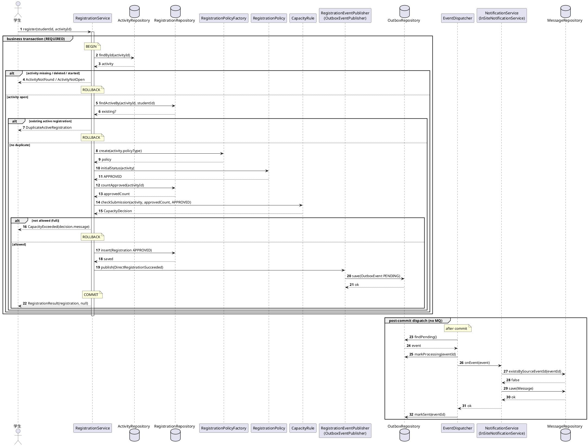
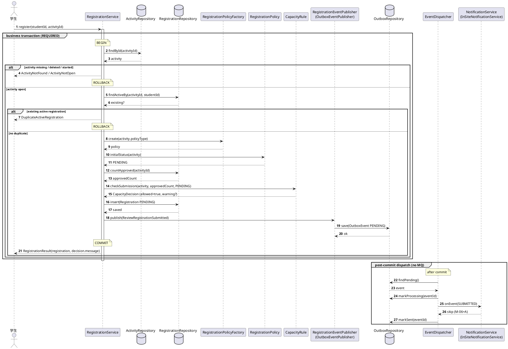
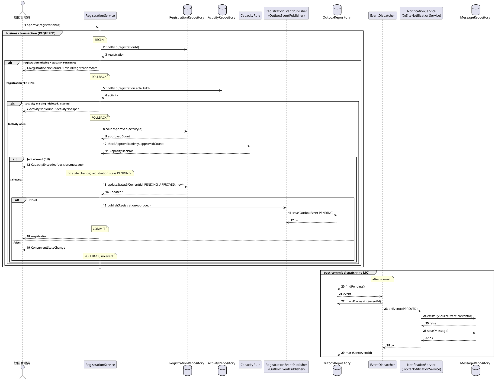
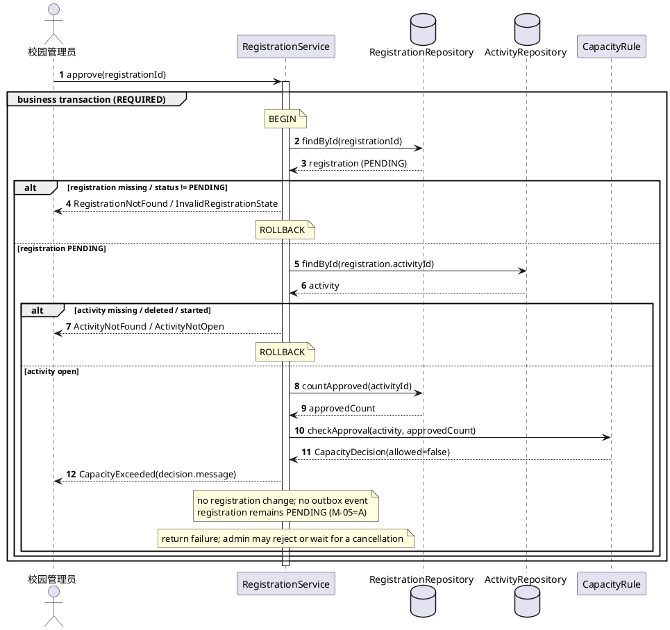
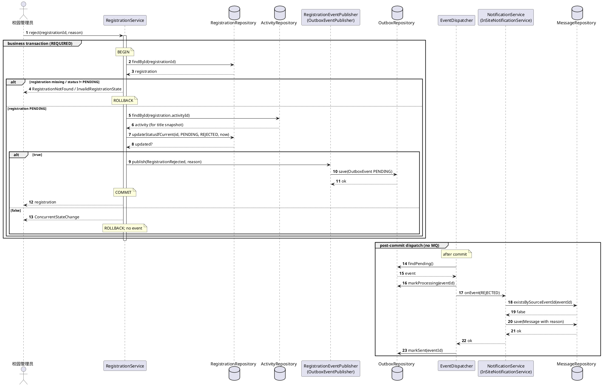
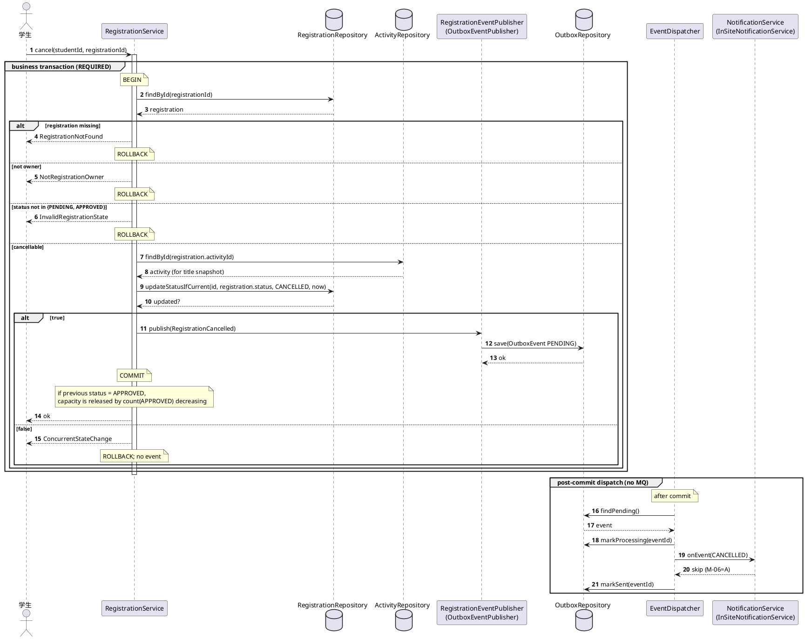

# CampusEvent 关键时序图与接口契约（第6批）

> 状态：`D6-01`～`D6-05` 已按建议确认；类图已同步；等待设计评审。本轮只做时序图与接口契约，不写实现代码。
>
> **依据**：`D4-01=C`（公共容量规则 + 策略初始状态）、`D5-02=C`（outbox + 事务后派发）、`M-06=A`（只通知直接通过/批准/拒绝）、`M-07=B`（同库 outbox，无消息队列）。
>
> **时序图源码**：`docs/diagrams/seq-register-direct.puml`、`seq-register-review.puml`、`seq-approve-success.puml`、`seq-approve-full.puml`、`seq-reject.puml`、`seq-cancel.puml`。本文嵌入同一份源码。
>
> **契约性质**：接口签名是设计契约，不是实现代码；异常与事务边界是调用方必须遵守的约束。

---

## 1. 阅读约定

- **实线箭头**：调用；**虚线箭头**：返回。
- **`group business transaction`**：业务事务边界；组内写报名/审批结果 + outbox。
- **`group post-commit dispatch`**：事务提交后的派发；失败不回滚业务。
- **`REQUIRED`**：加入调用方事务；**`MANDATORY`**：必须在事务内调用；**只读**：不要求事务。
- **无消息队列**：outbox 表是持久化事件缓冲；派发器可以由提交后钩子或定时任务触发。
- **通知范围**：`REGISTERED`/`APPROVED`/`REJECTED` 发通知；`SUBMITTED`/`CANCELLED` 仅审计（M-06=A）。

---

## 2. 报名时序图

### 2.1 直接报名

**关键不变量**

1. 活动存在、未软删除、`now < startAt`；否则拒绝（`ActivityNotFound`/`ActivityNotOpen`）。
2. 同一学生同一活动无“待审核/已通过”记录；否则 `DuplicateActiveRegistration`。
3. 提交时由 `CapacityRule.checkSubmission` 检查：`approvedCount < capacity`；满员则 `CapacityExceeded`。
4. 报名状态为 `APPROVED`；业务事务内写报名 + 一条 `REGISTERED` outbox 事件。
5. 通知在事务提交后由派发器处理；通知失败不回滚报名（D5-02=C）。
6. 直接报名不产生“待审核”状态，也使用直接通过。

**异常分支**

| 异常 | 触发点 | 事务结果 | 后续 |
|---|---|---|---|
| `ActivityNotFound` / `ActivityNotOpen` | 加载活动/检查时间 | 回滚；无报名、无事件 | 返回失败提示 |
| `DuplicateActiveRegistration` | 查重 | 回滚 | 提示已有有效报名 |
| `CapacityExceeded` | 容量规则 | 回滚 | 提示满员 |
| `PolicyNotFound` | 策略工厂 | 回滚 | 配置错误 |
| `OutboxPersistence` | 写 outbox | 回滚 | 报名不落库；用户重试 |
| `NotificationDelivery`（事务后） | 派发/写消息 | **不回滚报名** | outbox `FAILED`/重试；消息可能延迟 |

### 2.2 审核型申请

**关键不变量**

1. 活动存在、未软删除、`now < startAt`；否则拒绝。
2. 无重复有效报名；否则 `DuplicateActiveRegistration`。
3. 报名状态为 `PENDING`；待审核**不占名额**。
4. 满员时 `CapacityRule.checkSubmission` 返回 `allowed=true + warning`；未满时 `allowed=true` 无警告；`RegistrationResult.warning` 带回界面（M-04=A）。
5. 业务事务内写 `PENDING` 报名 + 一条 `SUBMITTED` outbox 事件；`SUBMITTED` 仅审计，不产生通知（M-06=A）。
6. 审批由管理员在后续动作完成；本用例不做名额硬检查。

**异常分支**

| 异常 | 触发点 | 事务结果 | 后续 |
|---|---|---|---|
| `ActivityNotFound` / `ActivityNotOpen` | 加载活动/检查时间 | 回滚 | 返回失败 |
| `DuplicateActiveRegistration` | 查重 | 回滚 | 提示已有有效报名 |
| `PolicyNotFound` | 策略工厂 | 回滚 | 配置错误 |
| `OutboxPersistence` | 写 outbox | 回滚 | 报名不落库 |
| 满员 | 容量规则 | **不回滚** | 允许提交，返回 warning |
| 通知 | 无 | — | `SUBMITTED` 被 `NotificationService` 跳过 |

---

## 3. 审批时序图

### 3.1 批准成功

**关键不变量**

1. 报名存在且为 `PENDING`；否则 `RegistrationNotFound`/`InvalidRegistrationState`。
2. 活动存在、未软删除、**未开始**；开始后禁止批准（M-03=C）。
3. 批准时重新统计 `approvedCount`，由 `CapacityRule.checkApproval` 做**硬检查**；不得超容量（C8/M-05=A）。
4. 条件更新 `PENDING → APPROVED` 成功后才写事件；同一状态只发一次。
5. 事件 `APPROVED`；通知在提交后派发。
6. 提交时的预检查不能替代批准时的硬检查。

**异常分支**

| 异常 | 触发点 | 事务结果 | 后续 |
|---|---|---|---|
| `RegistrationNotFound` / `InvalidRegistrationState` | 加载/状态检查 | 回滚 | 提示刷新 |
| `ActivityNotFound` / `ActivityNotOpen` | 加载活动/开始检查 | 回滚 | 拒绝批准 |
| `CapacityExceeded` | 批准硬检查 | **不回滚业务状态**；报名保持 `PENDING` | 提示满员；可拒绝或等待取消 |
| `ConcurrentStateChange` | 条件更新 0 行 | 回滚；无事件 | 提示刷新 |
| `OutboxPersistence` | 写 outbox | 回滚；保持 `PENDING` | 用户重试 |
| `NotificationDelivery`（事务后） | 派发/写消息 | **不回滚审批** | outbox `FAILED`/重试 |

### 3.2 批准时满额失败

**关键不变量**

1. 与批准成功相同的前置：报名 `PENDING`、活动未删除/未开始。
2. `CapacityRule.checkApproval` 返回 `allowed=false`；不调用 `updateStatusIfCurrent`。
3. 不改变报名状态、不写 outbox、不发通知；报名保持 `PENDING`（M-05=A）。
4. 管理员看到 `CapacityExceeded`；后续可拒绝该报名，或等已通过者取消后重试批准。

**异常分支**

- `CapacityExceeded` 是**预期结果**，不是系统故障；事务可以回滚/结束，但业务状态不变。
- 其他异常与 3.1 相同；因为没有状态变更，不会产生事件。

### 3.3 拒绝

**关键不变量**

1. 报名存在且为 `PENDING`；否则 `RegistrationNotFound`/`InvalidRegistrationState`。
2. 拒绝**不检查名额**；拒绝不占名额、不释放名额。
3. 活动开始后仍允许拒绝（M-03=C 的落地解释），用于清理待审核队列。
4. 条件更新 `PENDING → REJECTED` 成功后才写事件；同一状态只发一次。
5. 事件 `REJECTED`；通知在提交后派发，可带拒绝理由。
6. 拒绝后学生可立即重新申请（D-05）；旧记录保留，不复活。

**异常分支**

| 异常 | 触发点 | 事务结果 | 后续 |
|---|---|---|---|
| `RegistrationNotFound` / `InvalidRegistrationState` | 加载/状态检查 | 回滚 | 提示刷新 |
| 活动标题缺失 | 加载活动（标题快照） | 用兜底标题“活动”（D6-05 推荐） | 不阻塞拒绝 |
| `ConcurrentStateChange` | 条件更新 0 行 | 回滚；无事件 | 提示刷新 |
| `OutboxPersistence` | 写 outbox | 回滚 | 用户重试 |
| `NotificationDelivery`（事务后） | 派发/写消息 | **不回滚拒绝** | outbox `FAILED`/重试 |

---

## 4. 取消报名时序图

**关键不变量**

1. 报名存在、属于当前学生；否则 `RegistrationNotFound`/`NotRegistrationOwner`。
2. 状态只能是 `PENDING` 或 `APPROVED`；否则 `InvalidRegistrationState`。
3. 活动开始后仍允许取消（M-03=C）；不检查 `startAt`。
4. 条件更新为 `CANCELLED` 成功后才写事件；同一状态只发一次。
5. 若原状态为 `APPROVED`，名额通过“已通过计数减少”释放；当前设计不维护独立 `approved_count`，所以没有额外扣减步骤。若未来引入计数列，取消必须与状态更新同事务扣减。
6. 事件 `CANCELLED` 仅审计；不发通知（M-06=A）。
7. 活动标题快照缺失时用兜底标题“活动”（D6-05），不阻塞取消。

**异常分支**

| 异常 | 触发点 | 事务结果 | 后续 |
|---|---|---|---|
| `RegistrationNotFound` | 加载报名 | 回滚 | 提示不存在 |
| `NotRegistrationOwner` | 归属检查 | 回滚 | 拒绝越权 |
| `InvalidRegistrationState` | 状态检查 | 回滚 | 提示当前状态不可取消 |
| `ConcurrentStateChange` | 条件更新 0 行 | 回滚；无事件 | 提示刷新 |
| `OutboxPersistence` | 写 outbox | 回滚 | 用户重试 |
| 通知 | 无 | — | `CANCELLED` 被 `NotificationService` 跳过 |

---

## 5. 接口契约表

### 5.1 RegistrationService

| 方法 | 参数 | 返回 | 异常 | 事务边界 | 说明 |
|---|---|---|---|---|---|
| `register` | `studentId: String`, `activityId: String` | `RegistrationResult` | `ActivityNotFound`、`ActivityNotOpen`、`DuplicateActiveRegistration`、`CapacityExceeded`、`PolicyNotFound`、`OutboxPersistence` | `REQUIRED`；报名 insert + outbox 同事务 | 直接/审核由 `activity.policyType` 决定；直接满员抛 `CapacityExceeded`，审核满员返回 `warning` |
| `approve` | `registrationId: String` | `Registration` | `RegistrationNotFound`、`InvalidRegistrationState`、`ActivityNotFound`、`ActivityNotOpen`、`CapacityExceeded`、`ConcurrentStateChange`、`OutboxPersistence` | `REQUIRED`；条件更新 + outbox | 满员时 `CapacityExceeded`，保持 `PENDING`，无事件 |
| `reject` | `registrationId: String`, `reason: String?` | `Registration` | `RegistrationNotFound`、`InvalidRegistrationState`、`ConcurrentStateChange`、`OutboxPersistence` | `REQUIRED`；条件更新 + outbox | 不查名额；开始后仍可拒绝；`reason` 选填；活动标题缺失用兜底（D6-05） |
| `cancel` | `studentId: String`, `registrationId: String` | `void` | `RegistrationNotFound`、`NotRegistrationOwner`、`InvalidRegistrationState`、`ConcurrentStateChange`、`OutboxPersistence` | `REQUIRED`；条件更新 + outbox | 不查名额；开始后仍可取消；不发通知；活动标题缺失用兜底（D6-05） |
| `listByStudent` | `studentId: String` | `Registration[]` | `IllegalArgumentException` | 只读 | 返回本人报名历史 |
| `listPendingByActivity` | `activityId: String` | `Registration[]` | `IllegalArgumentException` | 只读 | 管理员待审核列表；权限在入口层 |

> `RegistrationResult`：`registration: Registration` + `warning: String?`。直接报名 warning 为 null；审核满员时带回警告。

### 5.2 RegistrationPolicy / CapacityRule

| 接口.方法 | 参数 | 返回 | 异常 | 事务/纯度 | 说明 |
|---|---|---|---|---|---|
| `RegistrationPolicy.initialStatus` | `activity: Activity` | `RegistrationStatus` | `IllegalArgumentException` | 纯函数；无事务 | 当前只返回 `APPROVED`/`PENDING` |
| `RegistrationPolicy.requiresApproval` | — | `boolean` | — | 纯函数 | 当前 `PENDING` 为 true |
| `CapacityRule.checkSubmission` | `activity: Activity`, `approvedCount: int`, `initialStatus: RegistrationStatus` | `CapacityDecision` | `IllegalArgumentException` | 纯函数；不查库、不开事务 | `APPROVED` 满员拒绝；`PENDING` 满员允许+警告 |
| `CapacityRule.checkApproval` | `activity: Activity`, `approvedCount: int` | `CapacityDecision` | `IllegalArgumentException` | 纯函数；不查库 | 满员拒绝；否则允许 |

> `CapacityDecision`：`allowed: boolean`、`warning: boolean`、`message: String`。

### 5.3 NotificationService / EventDispatcher / Publisher

| 接口.方法 | 参数 | 返回 | 异常 | 事务边界 | 说明 |
|---|---|---|---|---|---|
| `RegistrationEventPublisher.publish` | `event: RegistrationEvent` | `void` | `OutboxPersistence` | **`MANDATORY`**；加入调用方事务 | 只写 outbox；不直接发消息 |
| `RegistrationEventObserver.onEvent` | `event: RegistrationEvent` | `void` | `NotificationDelivery` | 调用方事务 | 订阅者端口 |
| `NotificationService.onEvent` | `event: RegistrationEvent` | `void` | `NotificationDelivery` | 派发器事务 | 只处理 `REGISTERED/APPROVED/REJECTED`；其余跳过 |
| `NotificationService.listByStudent` | `studentId: String` | `Message[]` | `IllegalArgumentException` | 只读 | 本人消息，按时间倒序 |
| `NotificationService.markRead` | `messageId: String`, `studentId: String` | `void` | `MessageNotFound`、`NotMessageOwner` | `REQUIRED` | 校验归属，防越权 |
| `NotificationService.unreadCount` | `studentId: String` | `int` | `IllegalArgumentException` | 只读 | 未读数 |
| `EventDispatcher.dispatchPending` | — | `void` | 基础设施异常 | 每事件独立事务 | 领取 PENDING；调用观察者；SENT/FAILED |

> `OutboxEventPublisher` 实现 `RegistrationEventPublisher`；`InSiteNotificationService` 实现 `NotificationService`。两者在组合根装配。
>
> `MessageRepository.save` 抛 `DuplicateNotification` 时，`NotificationService.onEvent` 视为**幂等成功**（消息已存在），不触发重试。

### 5.4 仓储端口

**ActivityRepository**

| 方法 | 参数 | 返回 | 异常 | 事务 | 说明 |
|---|---|---|---|---|---|
| `findById` | `id: String` | `Activity?` | `IllegalArgumentException` | 加入调用方 | 返回 null 表示不存在；服务翻译为 `ActivityNotFound` |
| `findByIdForUpdate` | `id: String` | `Activity?` | `IllegalArgumentException` | **必须在事务内**；悲观写锁 | D10-02：串行化同一活动的容量检查/报名/审批/编辑；锁到事务提交 |
| `save` | `activity: Activity` | `void` | 持久化异常 | 加入调用方 | 新建/更新 |
| `findVisible` | `keyword: String?` | `Activity[]` | — | 只读 | 排除软删除；名称筛选 |

**RegistrationRepository**

| 方法 | 参数 | 返回 | 异常 | 事务 | 说明 |
|---|---|---|---|---|---|
| `findById` | `id: String` | `Registration?` | — | 加入调用方 | null 表示不存在 |
| `insert` | `registration: Registration` | `void` | `DuplicateActiveRegistration`、持久化异常 | 加入调用方 | 新报名；唯一有效约束的最终防线 |
| `updateStatusIfCurrent` | `id: String`, `expected: RegistrationStatus`, `target: RegistrationStatus`, `now: DateTime` | `boolean` | 持久化异常 | 加入调用方；原子条件更新 | 返回 false 表示状态已变/并发冲突 |
| `findActiveBy` | `activityId: String`, `studentId: String` | `Registration?` | — | 加入调用方 | 状态 `PENDING/APPROVED` |
| `countApproved` | `activityId: String` | `int` | — | 加入调用方 | 只统计 `APPROVED` |
| `findPendingByActivity` | `activityId: String` | `Registration[]` | — | 只读 | 管理员待审核列表 |
| `findByStudent` | `studentId: String` | `Registration[]` | — | 只读 | 学生报名历史 |

**MessageRepository**

| 方法 | 参数 | 返回 | 异常 | 事务 | 说明 |
|---|---|---|---|---|---|
| `save` | `message: Message` | `void` | `DuplicateNotification`、持久化异常 | 加入调用方 | 唯一键 `(sourceEventId, studentId)` |
| `findByStudent` | `studentId: String` | `Message[]` | — | 只读 | 按 `createdAt` 倒序 |
| `markRead` | `messageId: String`, `studentId: String` | `void` | `MessageNotFound`、`NotMessageOwner` | `REQUIRED` | 归属校验 |
| `existsBySourceEventId` | `eventId: String` | `boolean` | — | 加入调用方 | 幂等预检查；唯一约束兜底 |
| `countUnread` | `studentId: String` | `int` | — | 只读 | 未读数 |

**OutboxRepository**

| 方法 | 参数 | 返回 | 异常 | 事务 | 说明 |
|---|---|---|---|---|---|
| `save` | `event: OutboxEvent` | `void` | 持久化异常 | 加入业务事务 | 与报名/审批同事务 |
| `findPending` | `limit: int` | `OutboxEvent[]` | — | 派发器事务 | 读取待派发 |
| `markProcessing` | `eventId: String` | `boolean` | — | 派发器事务；原子 | 领取事件；false 表示已被领取 |
| `markSent` | `eventId: String` | `void` | — | 派发器事务 | 成功/重复/跳过 |
| `markFailed` | `eventId: String`, `error: String`, `nextAttemptAt: DateTime` | `void` | — | 独立失败记录事务 | 重试次数/错误留痕 |

> **已确认并同步类图**：`RegistrationRepository` 使用 `insert` + `updateStatusIfCurrent`（D6-02）；`OutboxRepository` 增加 `markProcessing`（D6-03）。

### 5.5 异常分类

| 异常 | 含义 | 抛出者 | 事务影响 |
|---|---|---|---|
| `ActivityNotFound` | 活动不存在 | `RegistrationService` / `ActivityService` | 回滚 |
| `ActivityNotOpen` | 活动已删除/已开始 | `RegistrationService` | 回滚 |
| `DuplicateActiveRegistration` | 已有 `PENDING/APPROVED` 报名 | `RegistrationService` / 仓储 | 回滚 |
| `CapacityExceeded` | 名额不足 | `RegistrationService`（根据 `CapacityDecision`） | 直接报名回滚；批准保持 `PENDING` |
| `PolicyNotFound` | 未知 `policyType` | `RegistrationPolicyFactory` | 回滚 |
| `RegistrationNotFound` | 报名不存在 | `RegistrationService` | 回滚 |
| `InvalidRegistrationState` | 非法状态转换 | `Registration` / `RegistrationService` | 回滚 |
| `NotRegistrationOwner` | 非本人报名 | `RegistrationService` | 回滚 |
| `ConcurrentStateChange` | 条件更新 0 行 | `RegistrationService` | 回滚；无事件 |
| `OutboxPersistence` | outbox 写入失败 | `OutboxEventPublisher` | 业务回滚 |
| `NotificationDelivery` | 消息写入/派发失败 | `NotificationService` | 不回滚业务；outbox `FAILED`/重试 |
| `MessageNotFound` / `NotMessageOwner` | 消息不存在/非本人 | `NotificationService` / 仓储 | 只读/更新失败 |
| `IllegalArgumentException` | 空参数/非法输入 | 各接口 | 不进入业务事务 |

---

## 6. 契约与 SOLID/DIP 对应

| 原则 | 契约体现 |
|---|---|
| **SRP** | `RegistrationService` 只编排用例；`RegistrationPolicy` 只决定初始状态；`CapacityRule` 只做容量判断；`NotificationService` 只处理消息；仓储只做持久化 |
| **OCP** | 新增报名方式实现 `RegistrationPolicy`；新增容量语义扩展 `CapacityRule`；新增通知渠道实现 `RegistrationEventObserver`；`RegistrationService` 主流程不改 |
| **LSP** | `Direct/ReviewRegistrationPolicy` 满足 `RegistrationPolicy` 契约；`DefaultCapacityRule` 满足 `CapacityRule`；`InSiteNotificationService` 满足 `NotificationService` |
| **ISP** | 通知、事件发布/观察、各聚合仓储拆成小接口；没有“万能仓储”或“万能通知”接口 |
| **DIP** | `RegistrationService` 依赖 `ActivityRepository`、`RegistrationRepository`、`RegistrationPolicyFactory`、`CapacityRule`、`RegistrationEventPublisher` 抽象；`NotificationService` 依赖 `MessageRepository`；`EventDispatcher` 依赖 `OutboxRepository` + `RegistrationEventObserver` |

**事务边界也是契约**：

- `RegistrationEventPublisher.publish` 为 `MANDATORY`：必须在业务事务内调用；它只写 outbox，不直接发消息。
- `RegistrationService` 的写方法为 `REQUIRED`：状态变更 + outbox 原子提交。
- `NotificationService.onEvent` 在派发器事务中执行，**不在**报名事务中；失败不回滚报名。
- 这样 `RegistrationService` 不依赖 `NotificationService`/`MessageRepository`，DIP 与通知解耦同时成立。

---

## 7. 已确认决策与检查点

### 7.1 已确认

| 编号 | 事项 | 结论 | 落地 |
|---|---|---|---|
| **D6-01** | 事件载荷的 `studentName` | **保留为可选；不新增 `StudentRepository`** | 当前消息模板用“你”；需要称呼姓名时再补端口 |
| **D6-02** | `RegistrationRepository` 写接口 | **`insert` + `updateStatusIfCurrent`** | 已同步类图 |
| **D6-03** | `OutboxRepository` 领取接口 | **增加 `markProcessing`** | 已同步类图 |
| **D6-04** | `NotificationService.markRead` 失败语义 | **抛 `MessageNotFound`/`NotMessageOwner`** | 归属校验/可观测 |
| **D6-05** | 拒绝/取消时活动标题快照缺失 | **兜底标题“活动”** | 不阻塞拒绝/取消清理 |

### 7.2 检查点

- [x] 6 张时序图能渲染，且业务事务/事务后派发分组清晰。
- [x] 直接报名、审核申请、批准、批准满额失败、拒绝、取消六条路径的不变量与异常分支齐全。
- [x] `RegistrationService` 没有依赖 `NotificationService`/`MessageRepository`。
- [x] `publish` 标注 `MANDATORY`；`onEvent` 明确不在报名事务内。
- [x] 批准满额失败明确“报名保持 PENDING、无事件、无通知”。
- [x] 取消已通过报名说明“容量通过计数减少释放”，没有隐式计数器。
- [x] `insert` + `updateStatusIfCurrent`、`markProcessing`、`countUnread` 已同步类图。
- [x] `studentName` 取舍（D6-01）已确认。
- [ ] 设计评审通过后再进入下一批；本批不写代码。

---

## 8. 本轮文件变更

| 文件 | 操作 | 说明 |
|---|---|---|
| `实验/CampusEvent/docs/05-sequence-and-contracts.md` | 新增/修订 | 本文：6 张时序图、关键不变量、接口契约、SOLID/DIP、已确认决策 |
| `实验/CampusEvent/docs/02-class-diagram-v1.md` | 修订 | 同步 D6 契约（insert/updateStatusIfCurrent、markProcessing、studentName 可选） |
| `实验/CampusEvent/docs/diagrams/class-diagram-v1.puml` | 修订 | 类图同步 D6 契约 |
| `实验/CampusEvent/docs/diagrams/seq-register-direct.puml` | 新增 | 直接报名时序图 |
| `实验/CampusEvent/docs/diagrams/seq-register-review.puml` | 新增 | 审核型申请时序图 |
| `实验/CampusEvent/docs/diagrams/seq-approve-success.puml` | 新增 | 批准成功时序图 |
| `实验/CampusEvent/docs/diagrams/seq-approve-full.puml` | 新增 | 批准时满额失败时序图 |
| `实验/CampusEvent/docs/diagrams/seq-reject.puml` | 新增 | 拒绝时序图 |
| `实验/CampusEvent/docs/diagrams/seq-cancel.puml` | 新增 | 取消报名时序图 |

> 本轮未执行 Git 操作；未生成业务代码、数据库脚本、接口实现或部署文档。

---

## 9. 等待设计评审

请评审：

1. 6 张时序图是否覆盖直接报名、审核申请、批准、批准满额失败、拒绝、取消。
2. 第 5 节接口契约的异常与事务边界是否符合你的预期。
3. `D6-01`～`D6-05` 已按建议确认并同步类图；如评审发现不一致，请指出。

评审通过后再进入下一批；本轮不生成实现代码。
