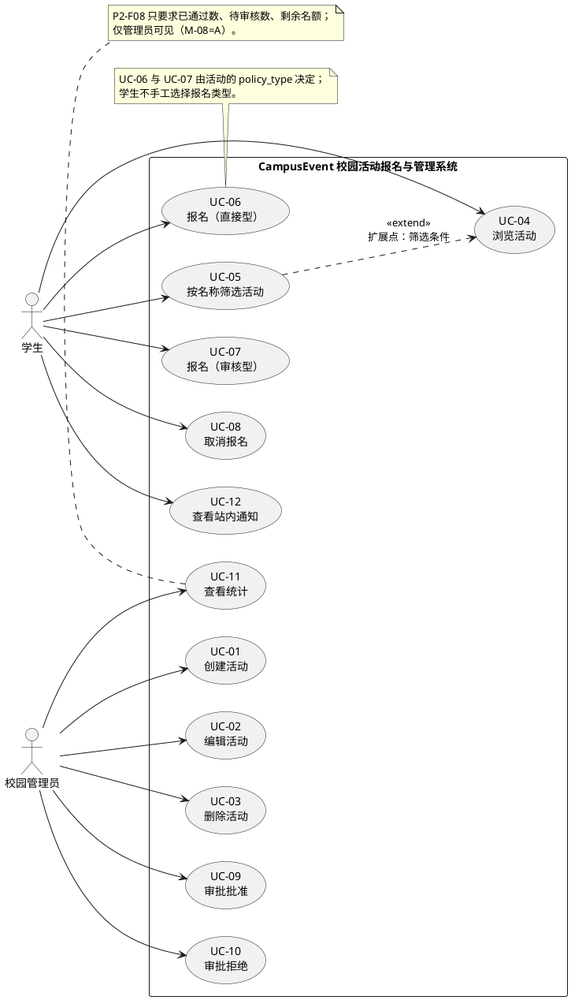
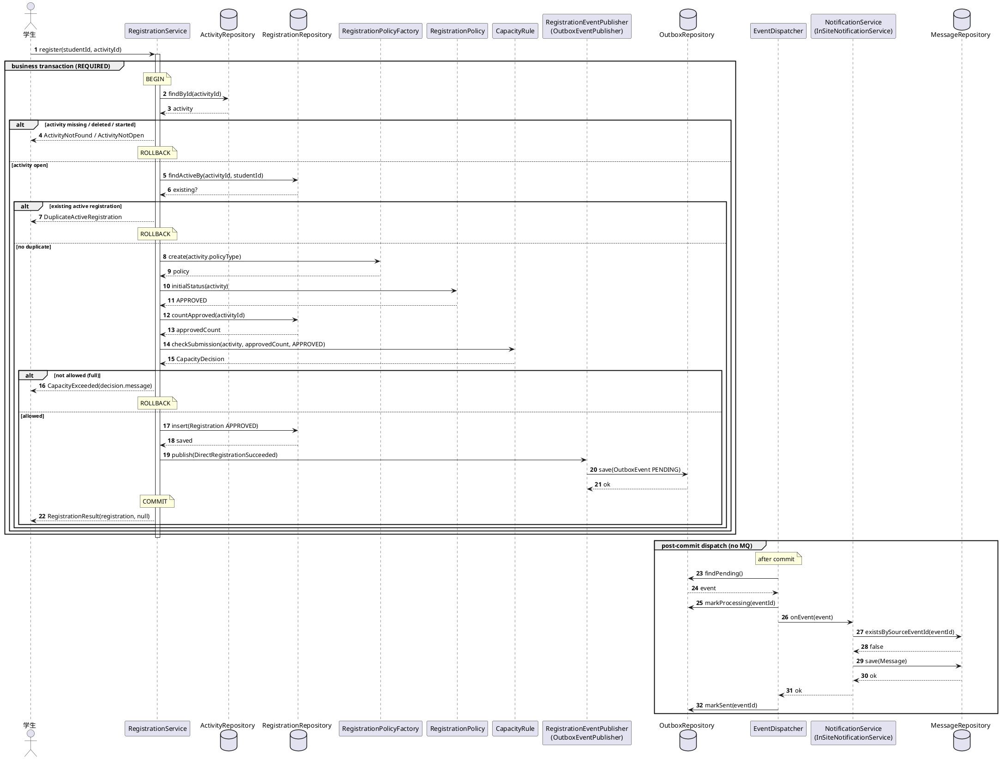
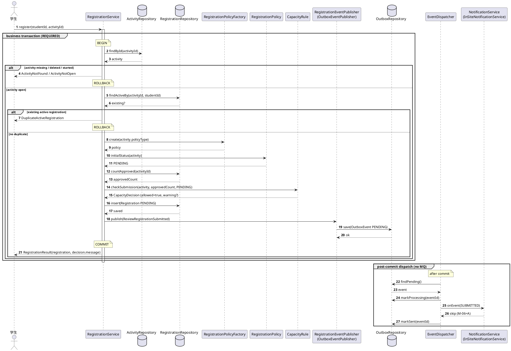
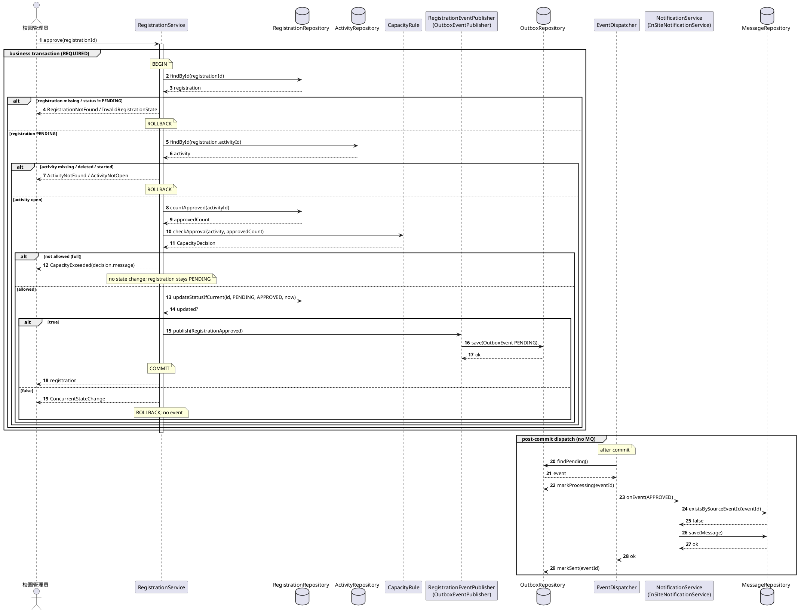
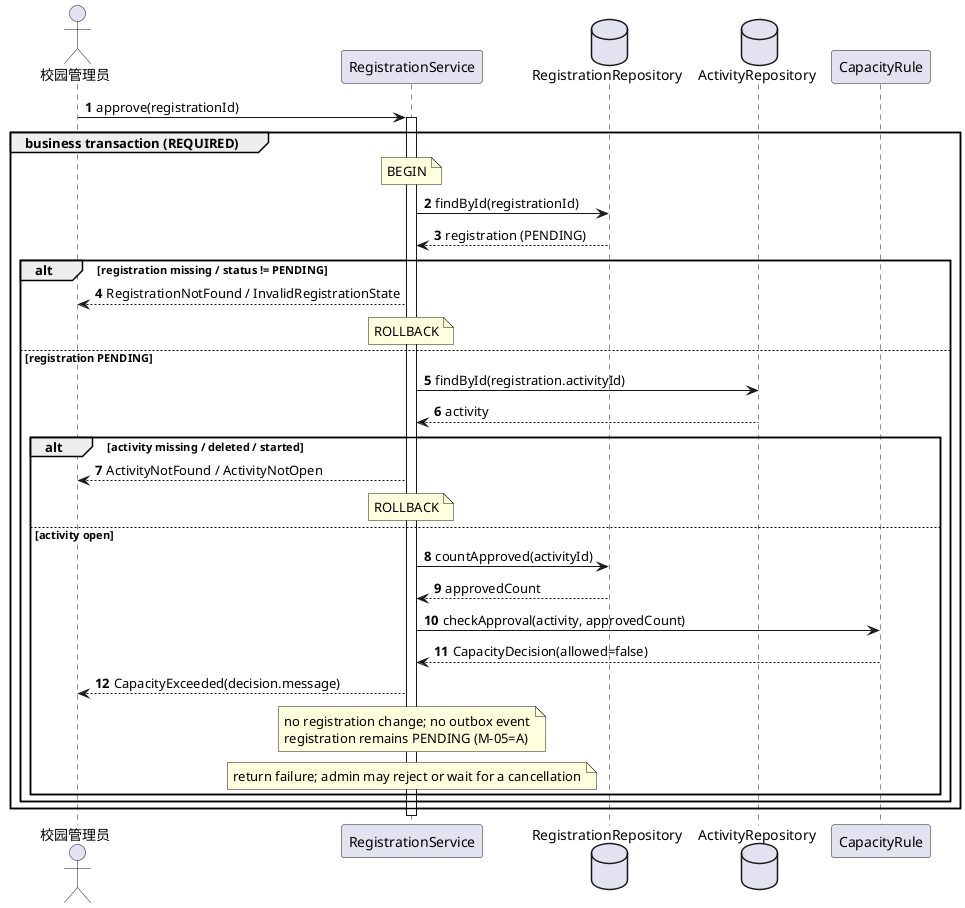
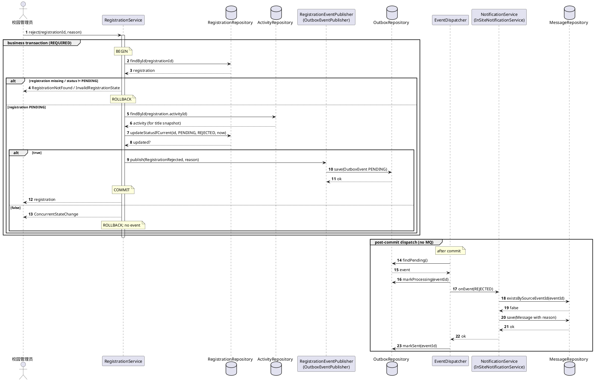
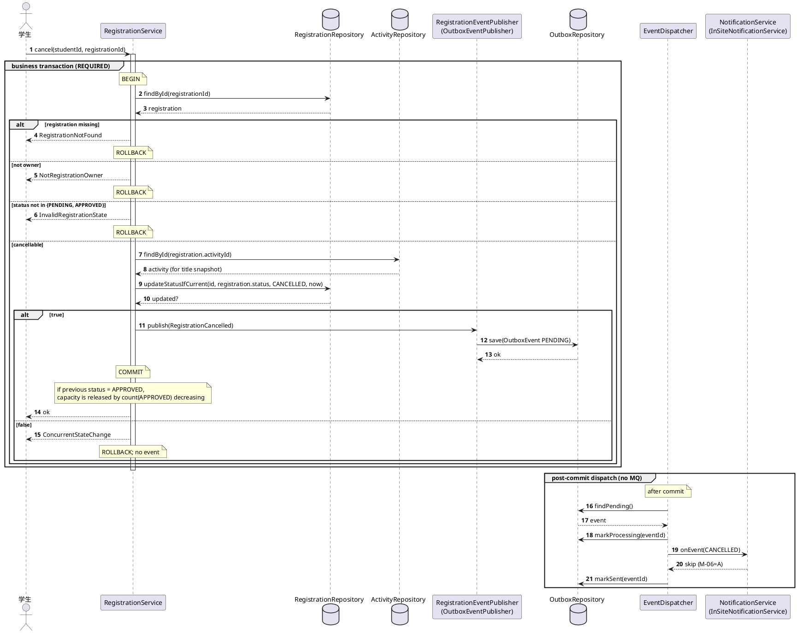

# CampusEvent 设计评审包（第7批）

> **评审对象**：第1～6批设计材料（需求分析、用例、类图、策略/通知决策、时序图、接口契约）。
>
> **评审状态**：待同行评审 / 待你签认。
>
> **通过条件**：第8节检查表通过，评审学生签名确认；通过后才进入实现。
>
> **重要**：本包不含业务代码。评审通过前不得生成实现代码；不提前实现教师后续发布的 CR。

---

## 0. 材料索引与阅读顺序

| 顺序 | 材料 | 路径 | 评审重点 |
|---|---|---|---|
| 1 | 需求依据 | `实验二.docx`、`附录.docx` 附录B | P2-F01～F08、B.1/B.2、C1～C10 |
| 2 | 用例说明 | `docs/01-use-cases.md` | 用例清单、主/异常流、需求追踪 |
| 3 | 用例图源码 | `docs/diagrams/use-case.puml` | 参与者、用例、关系 |
| 4 | 类图与职责边界 | `docs/02-class-diagram-v1.md` | 职责、关系、SOLID、状态机 |
| 5 | 类图源码 | `docs/diagrams/class-diagram-v1.puml` | 类、接口、依赖方向 |
| 6 | 策略/名额决策 | `docs/03-registration-policy-capacity.md` | 方案 A/B/C、选择理由、扩展点 |
| 7 | 通知解耦决策 | `docs/04-notification-decoupling.md` | 事务、幂等、失败处理 |
| 8 | 时序图与契约 | `docs/05-sequence-and-contracts.md` | 6 张时序图、接口契约、异常 |
| 9 | 状态机 | `docs/diagrams/state-registration.puml` | 合法/非法转换 |
| 10 | 本评审包 | `docs/06-design-review-package.md` | 汇总、覆盖表、检查表 |

> 6 张时序图源码：`docs/diagrams/seq-register-direct.puml`、`seq-register-review.puml`、`seq-approve-success.puml`、`seq-approve-full.puml`、`seq-reject.puml`、`seq-cancel.puml`。

---

## 1. 初始 SRS 分析摘要

### 1.1 产品范围

CampusEvent 是校园活动报名与管理系统：校园管理员发布/管理活动、审批报名；学生浏览活动、报名/取消；报名结果和审核结果通过站内消息通知；管理员查看活动统计。初始版本支持“直接报名”和“管理员审核”两类活动。

### 1.2 角色

| 角色 | 职责 | 约束 |
|---|---|---|
| 学生（Student） | 浏览活动、按名称筛选、报名、取消、查看站内通知 | 固定演示账号；不做注册与复杂权限 |
| 校园管理员（Admin） | 创建/编辑/删除活动、批准/拒绝待审核报名、查看统计 | 固定演示账号；不参与学生报名 |

### 1.3 功能需求（P2-F01～P2-F08）

| 编号 | 功能 | 初始版本要求 |
|---|---|---|
| P2-F01 | 活动管理 | 管理员创建、编辑、删除活动，设置名称、类型、时间、地点、人数上限、报名方式 |
| P2-F02 | 活动查看 | 学生浏览活动列表/详情，可按名称筛选 |
| P2-F03 | 报名/取消 | 学生报名、取消；禁止同一活动重复有效报名 |
| P2-F04 | 报名策略 | 直接报名自动通过；审核型进入待审核 |
| P2-F05 | 审批操作 | 管理员批准/拒绝待审核；批准时再次检查名额 |
| P2-F06 | 状态管理 | 待审核、已通过、已拒绝、已取消；转换符合规则 |
| P2-F07 | 站内通知 | 报名结果、审核结果写入站内消息列表 |
| P2-F08 | 统计 | 按活动查看已通过数、待审核数、剩余名额 |

### 1.4 领域数据（附录B B.1）

| 对象 | 主要字段 | 约束 |
|---|---|---|
| Student | `student_id`、`name` | 学生 ID 唯一 |
| Activity | `activity_id`、`title`、`category`、`start_at`、`location`、`capacity`、`policy_type` | 容量为正整数；活动开始前允许报名 |
| Registration | `registration_id`、`activity_id`、`student_id`、`status`、`created_at`、`updated_at` | 状态限待审核/已通过/已拒绝/已取消 |
| Message | `message_id`、`student_id`、`activity_id`、`content`、`created_at`、`is_read` | 报名/审核动作可产生站内消息 |

### 1.5 初始业务规则（附录B B.2）

1. 直接报名：名额充足且符合条件时创建“已通过”报名，并产生站内通知。
2. 审核型：提交为“待审核”；管理员批准/拒绝；批准时再次检查名额。
3. 名额只统计“已通过”；待审核不占名额；满员后不得再批准。
4. 同一学生同一活动不得有两条“待审核/已通过”有效报名；已拒绝/已取消保留历史，允许再次申请。
5. 学生可取消“待审核”或“已通过”报名；活动开始后不允许新增报名。
6. 通知失败要留痕，但不得导致已合法提交的报名无声消失。
7. 活动/报名必须持久化；删除已有报名的活动需在“拒绝删除并提示”与“软删除”中说明选择。

### 1.6 范围与约束

- 不做用户注册、复杂权限、多角色管理；使用固定演示账号。
- 使用 outbox + 观察者；通知解耦采用领域事件 + outbox + 观察者。
- 初始版本不做候补、签到、退款、管理员站内消息、软删除恢复。
- 技术栈、数据库、部署方式未定；实验二最终要求部署云服务器，但不在本轮决定。
- 教师发布 Change Request 前，不获取、不提前实现变更。

### 1.7 已确认的设计决策摘要

| 类别 | 决策 |
|---|---|
| 活动 | 创建即发布；仅 `start_at`；`category` 与 `policy_type` 两个字段；严格编辑约束；软删除且存在待审核时拒绝软删除 |
| 报名 | 直接/审核两种策略；名额只算已通过；满员时审核申请允许+警告；批准满员保持待审核；开始后禁止批准，允许拒绝/取消 |
| 通知 | 只通知直接通过/批准/拒绝；outbox + 事务后派发；`(sourceEventId, studentId)` 幂等；失败重试/留痕 |
| 名额 | `D4-01=C`：公共 `CapacityRule` + 策略只决定初始状态；批准时硬检查 |
| 契约 | `RegistrationRepository` 用 `insert` + `updateStatusIfCurrent`；`OutboxRepository` 有 `markProcessing`；`studentName` 可选 |

---

## 2. 用例清单与用例图

### 2.1 用例清单

| 编号 | 用例 | 参与者 | 目标 | 关联需求 |
|---|---|---|---|---|
| UC-01 | 创建活动 | 管理员 | 建立可浏览/报名的活动 | P2-F01 |
| UC-02 | 编辑活动 | 管理员 | 修正活动且不破坏报名一致性 | P2-F01 |
| UC-03 | 删除活动 | 管理员 | 移除活动并保留历史 | P2-F01；B.2-7 |
| UC-04 | 浏览活动 | 学生 | 了解活动、名额、报名方式 | P2-F02 |
| UC-05 | 按名称筛选 | 学生 | 快速定位活动 | P2-F02 |
| UC-06 | 报名（直接型） | 学生 | 立即获得“已通过” | P2-F03/F04 |
| UC-07 | 报名（审核型） | 学生 | 提交待审核 | P2-F03/F04 |
| UC-08 | 取消报名 | 学生 | 撤销报名并释放名额 | P2-F03/F06 |
| UC-09 | 审批批准 | 管理员 | 待审核转已通过 | P2-F05 |
| UC-10 | 审批拒绝 | 管理员 | 拒绝待审核并告知 | P2-F05 |
| UC-11 | 查看统计 | 管理员 | 查看已通过/待审核/剩余名额 | P2-F08 |
| UC-12 | 查看站内通知 | 学生 | 查看本人通知 | P2-F07 |

- 用例粒度：创建/编辑/删除分开；直接/审核报名分开；批准/拒绝分开。
- 详细主流程/异常流/前后置条件见 `docs/01-use-cases.md` 第4节。
- 官方 C1～C10 的覆盖追踪见 `docs/01-use-cases.md` §2.3（只引用，不新增）。

### 2.2 用例图源码

源码见**附录A**；文件为 `docs/diagrams/use-case.puml`。

### 2.3 用例关系

- `UC-05 → UC-04` 为 `<<extend>>`：筛选是浏览列表的可选增强。
- `UC-06`/`UC-07` 保持独立：报名方式由 `Activity.policy_type` 决定，学生不手工选择。
- `UC-09`/`UC-10` 分开：批准涉及名额二次检查，拒绝不涉及。
- 管理员不参与学生报名；管理员用待审核列表，不建管理员站内消息。

---

## 3. UML 类图 V1 与职责边界

### 3.1 类图源码

源码文件：`docs/diagrams/class-diagram-v1.puml`。完整源码见附录B；核心职责如下。

### 3.2 类职责边界

| 类/接口 | 职责 | 不应承担 |
|---|---|---|
| `Student` | 身份、姓名 | 报名规则、名额、通知、权限 |
| `Activity` | 活动数据、时间/容量事实、软删除标记、编辑约束 | 报名持久化、状态变更、通知、统计聚合 |
| `Registration` | 报名状态机、有效报名判断 | 活动级名额检查、通知、持久化、权限 |
| `ActivityService` | 活动 CRUD、浏览/筛选、软删除/缩容前置检查 | 报名状态变更、审批、通知 |
| `RegistrationService` | 报名/取消/审批编排；查重；调用容量规则；保存；发布事件 | 通知内容、直接写 Message、SQL、活动 CRUD、容量规则本身 |
| `RegistrationPolicy` | 只决定初始状态/是否审批 | 持久化、通知、名额检查 |
| `Direct/ReviewRegistrationPolicy` | 直接型/审核型的初始状态 | 名额检查、通知、审批动作 |
| `CapacityRule` | 提交检查 + 批准硬检查；纯函数 | 持久化、通知、策略选择 |
| `NotificationService` | 站内通知端口/观察者；查询/已读/未读数 | 报名状态、事件发布、活动/名额规则 |
| `InSiteNotificationService` | 幂等写 Message；查询/已读 | 报名规则、事件发布、容量 |
| `RegistrationEvent` | 领域事件（5 类型 + 快照字段） | 持久化、业务规则 |
| `OutboxEventPublisher` | 业务事务内写 outbox | 直接写 Message、调用观察者 |
| `EventDispatcher` | 领取 PENDING；调用观察者；SENT/FAILED；重试 | 报名业务、消息内容 |
| `ActivityRepository` 等 | 持久化端口 | 业务规则 |

### 3.3 关系与聚合边界

- `Student 1 — 0..* Registration`、`Activity 1 — 0..* Registration`：**关联**，不是组合。
- `Student/Activity 1 — 0..* Message`：关联；活动软删除后消息仍可追溯。
- 实体只存 ID（`activityId`/`studentId`），不持有对象引用；避免级联加载与耦合。
- `Activity`、`Student`、`Registration`、`Message` 作为独立聚合根；跨聚合的容量/重复规则由 `RegistrationService` 在事务中编排。
- 不用组合的理由：报名有独立身份/历史，活动软删除后仍保留；组合会暗示级联删除，与 B.2-7 冲突。
- 名额检查是跨聚合规则：`CapacityRule` 纯函数接收 `approvedCount`，不查库；Service 持有事务与锁。

### 3.4 状态机

| 起始 | 事件 | 目标 | 合法性 |
|---|---|---|---|
| 无记录 | 直接报名 | 已通过 | 合法：活动未开始、无重复、名额充足 |
| 无记录 | 审核报名 | 待审核 | 合法：活动未开始、无重复 |
| 待审核 | 批准 | 已通过 | 合法：活动未开始、名额充足 |
| 待审核 | 拒绝 | 已拒绝 | 合法；开始后仍允许 |
| 待审核 | 取消 | 已取消 | 合法；开始后仍允许 |
| 已通过 | 取消 | 已取消 | 合法；开始后仍允许 |
| 已拒绝/已取消 | 任何转换 | — | 非法；重新申请创建新记录 |
| 已通过 | 拒绝 | — | 非法；退出走取消 |
| 待审核/已通过 | 重复有效报名 | — | 非法；唯一约束拦截 |

> 状态机源码：`docs/diagrams/state-registration.puml`。

---

## 4. 时序图索引

| 场景 | 源码文件 | 关键不变量 | 主要异常 |
|---|---|---|---|
| 直接报名 | `seq-register-direct.puml` | 活动开放、无重复、名额充足；APPROVED + `REGISTERED` 事件 | 活动不存在/已开始、重复、满员、outbox 失败 |
| 审核型申请 | `seq-register-review.puml` | PENDING；待审核不占名额；满员允许+警告；`SUBMITTED` 仅审计 | 活动不存在/已开始、重复、outbox 失败 |
| 批准成功 | `seq-approve-success.puml` | PENDING + 活动未开始 + 批准硬检查；条件更新；`APPROVED` 事件 | 状态冲突、活动已开始、满员、并发、outbox 失败 |
| 批准满额失败 | `seq-approve-full.puml` | 硬检查失败；不改变状态、不写事件、不通知；保持 PENDING | `CapacityExceeded` |
| 拒绝 | `seq-reject.puml` | 不查名额；开始后仍可拒绝；`REJECTED` 事件+通知 | 状态冲突、并发、outbox 失败 |
| 取消 | `seq-cancel.puml` | 本人 + PENDING/APPROVED；开始后仍可取消；`CANCELLED` 仅审计；已通过取消通过计数释放名额 | 非本人、状态不允许、并发、outbox 失败 |

- 6 张源码均在 `docs/diagrams/`；完整内嵌与接口契约见 `docs/05-sequence-and-contracts.md` 第2～5节。
- 所有写路径：业务事务内写状态 + outbox；提交后派发；通知失败不回滚业务。
- 直接/批准/拒绝：提交后写 Message；审核提交/取消：`NotificationService` 跳过。

---

## 5. 策略模式决策报告

### 5.1 问题

报名规则有两类：直接报名自动通过、审核型进入待审核。名额检查放在哪里？这是策略设计的核心决策。

### 5.2 备选方案

| 方案 | 做法 | 优点 | 缺点 |
|---|---|---|---|
| A | `RegistrationService` 私有公共规则 | 一份实现、简单 | 提交阶段要按状态特判，策略差异回到 Service |
| B | 名额检查放进 `RegistrationPolicy` | 策略完整、扩展强 | 容量逻辑可能重复；批准硬检查可能被策略绕过 |
| C' | Service 硬不变量 + Policy `preCheck`（第3批混合） | 显式、安全 | 两个检查点、策略接口更重 |
| **C** | **公共 `CapacityRule` + 策略只决定初始状态（已选）** | **一份容量实现、批准硬检查集中、策略最小** | **`CapacityRule` 按 `initialStatus` 区分满员行为；未来候补需扩展规则** |

### 5.3 已选方案：C

- `RegistrationPolicy`：`initialStatus(Activity)` + `requiresApproval()`；只回答“初始状态/是否需要审批”。
- `DirectRegistrationPolicy`：初始 `APPROVED`，直接通过。
- `ReviewRegistrationPolicy`：初始 `PENDING`，需要审批。
- `CapacityRule.checkSubmission(activity, approvedCount, initialStatus)`：
  - 未满 → 允许；
  - 满员 + `APPROVED` → 拒绝（直接报名）；
  - 满员 + `PENDING` → 允许 + 警告（M-04=A）。
- `CapacityRule.checkApproval(activity, approvedCount)`：满员 → 拒绝；否则允许（C8/M-05=A）。
- `RegistrationService`：提交调用 `checkSubmission`；批准调用 `checkApproval`；没有 `if policyType == ...`。
- 选择理由：一份容量实现；批准硬检查集中；策略最小；纯函数 + Service 事务；当前需求全覆盖。
- 代价：`CapacityRule` 隐含状态语义；未来 `WAITLISTED` 需要扩展规则；不如 B 那样让策略完全自定义容量语义。

### 5.4 扩展点

| 未来变化 | 需要改的类 | 保持不变的类 |
|---|---|---|
| 新增“先到先得” | 若等同直接型，使用现有直接型策略；否则新增 `RegistrationPolicy` 实现 + 工厂映射 | `RegistrationService` 主流程 |
| 新增“候补” | `RegistrationStatus` 加 `WAITLISTED`（或独立实体）、`WaitlistRegistrationPolicy`、`CapacityRule` 新模式、`RegistrationService` 加入/转正、`RegistrationRepository` 候补查询、`RegistrationEventType` + 通知、统计 | `Student`、`Message` 基本结构；outbox/dispatcher 结构 |
| 新增通知渠道 | 新增 `RegistrationEventObserver` 实现并注册 | `RegistrationService`、`CapacityRule` |

> 完整论证见 `docs/03-registration-policy-capacity.md`。

---

## 6. 通知解耦决策报告

### 6.1 结构

- **领域事件分发**：业务事务写 `OutboxEvent`；提交后 `EventDispatcher` 领取并调用观察者；`InSiteNotificationService` 写 `Message`。
- **不选纯观察者**：纯观察者无持久化/重试，崩溃或异常会丢事件；outbox 可重试/留痕。
- **使用 outbox + 观察者**：outbox 表就是持久化缓冲；派发器是进程内组件。
- **观察者只用于订阅端**：`NotificationService` 实现 `RegistrationEventObserver`；整体结构是领域事件分发。

### 6.2 事件与通知范围

| 事件 | 通知 | 说明 |
|---|---|---|
| `REGISTERED`（直接成功） | 是 | 报名成功 |
| `SUBMITTED`（审核提交） | 否 | 仅审计（M-06=A） |
| `APPROVED`（批准） | 是 | 报名已通过 |
| `REJECTED`（拒绝） | 是 | 报名未通过，可带理由 |
| `CANCELLED`（取消） | 否 | 仅审计（M-06=A） |

### 6.3 通知事务方案

| 方案 | 报名是否受通知失败影响 | 静默丢失窗口 | 结论 |
|---|---|---|---|
| A 同事务 | 是（消息失败回滚报名） | 无 | 不推荐；通知成为硬依赖 |
| B 独立事务+失败记录 | 否 | 有（提交后崩溃） | 可作简化版，不完全满足 B.2-6 |
| **C outbox + 事务后派发（已选）** | **否（投递失败）；outbox 写入失败会回滚业务** | **无（事件已持久化）** | **推荐；与 M-07=B 一致** |

- 业务事务：报名/审批状态 + outbox 原子提交。
- 派发事务：领取事件、调用通知、写 Message、标记 SENT/FAILED；不包含报名业务。
- 通知失败不回滚报名；outbox `FAILED` + `lastError`/重试留痕。
- 推荐：提交后立即尝试一次派发（低延迟），失败交给重试任务。

### 6.4 幂等与失败处理

- `eventId` 唯一；outbox 唯一索引。
- `Message` 唯一键 `(sourceEventId, studentId)`；`existsBySourceEventId` 预检查。
- 状态变更用条件更新，只有实际变更才写事件；重复请求/重试不产生第二条有效报名/事件。
- 派发 at-least-once；消息唯一键保证效果上 once。
- 重试 5 次、指数退避（1m/5m/15m/1h）；超过上限 `FAILED` + 日志。
- `NotificationService.onEvent` 只处理 3 类通知；`SUBMITTED`/`CANCELLED` 跳过；重复/跳过正常返回，基础设施失败抛 `NotificationDelivery`。

### 6.5 DIP

```text
RegistrationService → RegistrationEventPublisher
EventDispatcher → OutboxRepository + RegistrationEventObserver
NotificationService → MessageRepository
```

`RegistrationService` 不知道 `NotificationService`/`MessageRepository`；通知实现不知道报名服务；具体实现只在组合根装配。完整见 `docs/04-notification-decoupling.md`。

---

## 7. 设计原则说明与复杂度

### 7.1 SOLID 对应

| 原则 | 体现 |
|---|---|
| **SRP** | Activity 数据/时间/容量；Registration 状态机；RegistrationService 编排；CapacityRule 容量；NotificationService 消息；仓储持久化 |
| **OCP** | 新报名方式实现 RegistrationPolicy；新容量语义扩展 CapacityRule；新通知渠道实现 Observer；Service 主流程不改 |
| **LSP** | Direct/Review 满足 RegistrationPolicy；DefaultCapacityRule 满足 CapacityRule；InSite 满足 NotificationService |
| **ISP** | 通知、事件发布/观察、各聚合仓储拆成小接口；没有万能接口 |
| **DIP** | Service 依赖仓储/策略工厂/容量规则/事件发布抽象；通知依赖 MessageRepository；Dispatcher 依赖 Outbox/ Observer |

### 7.2 模式应用理由

| 模式/结构 | 用途 | 为什么需要 |
|---|---|---|
| 策略（RegistrationPolicy） | 直接/审核两种报名规则 | 避免 `if policyType`；方便新增报名方式 |
| 公共规则（CapacityRule） | 名额提交检查 + 批准硬检查 | 一份实现；批准安全边界集中 |
| 工厂（RegistrationPolicyFactory） | 按 policyType 选择策略 | 隔离选择逻辑 |
| 领域事件 + outbox | 报名与通知解耦 | 通知失败不影响报名；可重试/留痕；无 MQ |
| 观察者 | 通知订阅端 | 新增通知渠道不改报名 |
| 仓储（Repository） | 持久化端口 | DIP、可测试、技术栈后置 |
| 状态机（Registration） | 状态转换守卫 | 非法转换集中处理 |

### 7.3 模式带来的复杂度（如实说明）

- 类比“直接 if/else + 直接写消息”多：策略/工厂/容量规则、outbox 表、dispatcher、observer、多个仓储接口。
- 调用链变长：`RegistrationService → Publisher → Outbox → Dispatcher → NotificationService → MessageRepository`。
- 通知是最终一致：可能延迟；需要重试/失败记录；比同步写消息难排查。
- 两个事务边界：业务事务 + 派发事务；需要测试“提交后失败/重试/重复”。
- 事件 schema/版本、幂等键、outbox 状态管理都是额外成本。
- 软删除使活动查询/统计都要过滤 `deletedAt`；通知中的活动入口要处理“已删除”。
- 若需求永不变化、只有两种策略且通知永远成功，简单实现更短；本实验有变更阶段与 B.2-6 可靠性要求，因此保留抽象。

### 7.4 刻意保持简单

- 不做 CQRS、通用 Repository、Clock 抽象、通用事件总线、消息队列。
- 不做候补、签到、退款、管理员站内消息、软删除恢复。
- `studentName` 可选，不新增 StudentRepository；当前消息用“你”。
- `CapacityRule` 只有默认实现，不为两个分支再加工厂。
- `RegistrationService` 保留少量查询方法，不拆 CQRS。

### 7.5 主要风险

- `CapacityRule` 按 `initialStatus` 区分满员行为，未来 `WAITLISTED` 需扩展；新增状态时可能改规则。
- 通知最终一致；若产品要求“报名成功即刻可见通知”，需要提交后同步尝试一次并接受延迟/重试。
- 唯一约束/条件更新的具体 SQL 依赖数据库；SQLite/MySQL/PostgreSQL 写法不同。
- 软删除与统计口径需要在实现时统一过滤。
- 无 `StudentRepository`，学生数据由固定演示账号/认证上下文提供；若需要学生管理要补端口。

---

## 8. 设计评审检查表

> 评审人逐项填写“通过/不通过/不适用”，并在文末签名。可打印版本：`docs/review/design-review-checklist.md`。

### 8.1 职责是否清晰

| # | 检查项 | 结论 | 备注 |
|---|---|---|---|
| 1 | 每个类/接口有单一、明确的职责 |  |  |
| 2 | `RegistrationService` 只编排，不写消息/不写 SQL |  |  |
| 3 | `Registration` 只守状态机，不做名额/通知 |  |  |
| 4 | `CapacityRule` 纯函数，不查库/不开事务 |  |  |
| 5 | `NotificationService` 只做消息，不改报名 |  |  |
| 6 | 仓储只做持久化，不含业务规则 |  |  |

### 8.2 类图是否正确

| # | 检查项 | 结论 | 备注 |
|---|---|---|---|
| 7 | 类、接口、枚举齐全，无关键概念缺失 |  |  |
| 8 | 关联/多重性正确；Registration/Message 不被误画成组合 |  |  |
| 9 | 依赖方向符合 DIP；Service 不依赖通知实现 |  |  |
| 10 | 状态机覆盖合法/非法转换 |  |  |
| 11 | 类图与第5节接口契约一致（insert/updateStatusIfCurrent/markProcessing） |  |  |
| 12 | 图中没有把数据库/页面/HTTP 当作领域类 |  |  |

### 8.3 需求覆盖

| # | 检查项 | 结论 | 备注 |
|---|---|---|---|
| 13 | P2-F01～F08 都能追到用例/类/接口 |  |  |
| 14 | B.2-1～7 都能追到规则/实体/服务/契约 |  |  |
| 15 | 直接/审核、批准/拒绝、取消、通知、统计都有设计落点 |  |  |
| 16 | 软删除、重复报名、满员、开始后审批/取消有明确处理 |  |  |
| 17 | 官方 C1～C10 的追踪见 `01-use-cases.md` §2.3，无新增/推测 |  |  |

### 8.4 接口是否稳定

| # | 检查项 | 结论 | 备注 |
|---|---|---|---|
| 18 | `RegistrationPolicy` 最小（initialStatus/requiresApproval），不掺容量 |  |  |
| 19 | `CapacityRule` 输入纯数据（activity/approvedCount/status），无仓储依赖 |  |  |
| 20 | `RegistrationEventPublisher.publish` 为 MANDATORY，outbox 与业务同事务 |  |  |
| 21 | `NotificationService.onEvent` 不在报名事务内；失败不回滚报名 |  |  |
| 22 | 仓储接口按聚合拆分；`insert` + `updateStatusIfCurrent` 支持并发/幂等 |  |  |
| 23 | 异常语义与事务边界在契约表中写明 |  |  |

### 8.5 是否有过度设计

| # | 检查项 | 结论 | 备注 |
|---|---|---|---|
| 24 | 策略/容量规则是否确有必要（两种报名方式 + 可变规则） |  |  |
| 25 | outbox/dispatcher 的复杂度是否由 B.2-6/通知可靠性证明 |  |  |
| 26 | 是否有可以删掉的抽象（如不必要的工厂/接口） |  |  |
| 27 | 是否保留了“简单实现”的边界（无 MQ/CQRS/通用仓储） |  |  |
| 28 | 模式成本是否在报告中如实说明 |  |  |

### 8.6 事务、异常、边界

| # | 检查项 | 结论 | 备注 |
|---|---|---|---|
| 29 | 报名/审批：状态 + outbox 原子；通知失败不回滚 |  |  |
| 30 | 批准满额：保持 PENDING、无事件、无通知 |  |  |
| 31 | 取消已通过：容量通过计数减少释放，无隐式计数器 |  |  |
| 32 | 重复报名：应用检查 + DB 唯一约束 |  |  |
| 33 | 最后名额/并发审批：行锁或条件更新 |  |  |
| 34 | 通知重复：eventId + Message 唯一键；at-least-once 幂等 |  |  |

### 8.7 评审结论

| 项 | 内容 |
|---|---|
| 评审人姓名/学号 |  |
| 评审日期 |  |
| 评审版本 | 第1～6批设计包（v1） |
| 结论 | □ 通过　□ 有条件通过　□ 不通过 |
| 必须修改项 |  |
| 建议修改项 |  |
| 评审人签名 |  |

> 按实验二 3.3 设计任务 D，评审学生必须签名确认后才能进入 AI 实现阶段。

---

## 9. 本轮待你决策项/建议检查点

### 9.1 待你决策

| 编号 | 事项 | 说明 |
|---|---|---|
| **R7-01** | 设计评审结论 | 通过 / 有条件通过 / 不通过；通过后你明确说“设计评审通过，可以进入实现” |
| R7-02 | 同行评审签名 | 按实验二 3.3 任务 D，需其他学生签名；签名记录附在本包/检查表 |
| R7-03 | 评审发现的修改 | 若评审提出职责/类图/契约问题，先修订再进入实现 |
| R7-04 | 技术栈/数据库/部署 | 未定；等后续批次或你指定，不在本包决定 |
| R7-05 | 教师 CR | 未发布；不提前实现，等变更阶段 |

### 9.2 建议检查点

- [ ] 本包能独立阅读，材料索引路径正确。
- [ ] 第8节检查表全部通过，评审人已签名。
- [ ] 设计评审发现的问题已关闭。
- [ ] 你已明确说“设计评审通过，可以进入实现”。
- [ ] 未通过前没有生成业务代码。

---

## 附录A：用例图源码



## 附录B：UML 类图 V1 源码

```plantuml
@startuml
skinparam classAttributeIconSize 0
skinparam packageStyle rectangle
skinparam shadowing false
hide empty members

package "domain" {
  class Student {
    - studentId: String
    - name: String
    + getId(): String
  }

  class Activity {
    - activityId: String
    - title: String
    - category: String
    - startAt: DateTime
    - location: String
    - capacity: int
    - policyType: PolicyType
    - deletedAt: DateTime
    + isDeleted(): boolean
    + hasStarted(now: DateTime): boolean
    + isOpenForRegistration(now: DateTime): boolean
    + canReduceCapacityTo(newCapacity: int, approvedCount: int): boolean
  }

  class Registration {
    - registrationId: String
    - activityId: String
    - studentId: String
    - status: RegistrationStatus
    - createdAt: DateTime
    - updatedAt: DateTime
    + approve(now: DateTime): void
    + reject(now: DateTime): void
    + cancel(now: DateTime): void
    + isActive(): boolean
  }

  enum RegistrationStatus {
    PENDING
    APPROVED
    REJECTED
    CANCELLED
  }

  enum PolicyType {
    DIRECT
    REVIEW
  }

  class Message {
    - messageId: String
    - studentId: String
    - activityId: String
    - sourceEventId: String
    - type: NotificationType
    - title: String
    - content: String
    - createdAt: DateTime
    - isRead: boolean
    - readAt: DateTime
    + markRead(now: DateTime): void
  }

  enum NotificationType {
    REGISTRATION_SUCCESS
    REGISTRATION_APPROVED
    REGISTRATION_REJECTED
  }
}

package "application" {
  class ActivityService {
    - activityRepo: ActivityRepository
    - registrationRepo: RegistrationRepository
    + create(...): Activity
    + update(...): Activity
    + softDelete(activityId: String): void
    + listVisible(keyword: String): Activity[]
    + getDetail(activityId: String): Activity
  }

  class RegistrationService {
    - activityRepo: ActivityRepository
    - registrationRepo: RegistrationRepository
    - policyFactory: RegistrationPolicyFactory
    - capacityRule: CapacityRule
    - eventPublisher: RegistrationEventPublisher
    + register(studentId: String, activityId: String): RegistrationResult
    + cancel(studentId: String, registrationId: String): void
    + approve(registrationId: String): Registration
    + reject(registrationId: String, reason: String): Registration
    + listByStudent(studentId: String): Registration[]
    + listPendingByActivity(activityId: String): Registration[]
  }

  class StatisticsService {
    - activityRepo: ActivityRepository
    - registrationRepo: RegistrationRepository
    + getActivityStatistics(activityId: String): ActivityStatistics
    + getAll(): ActivityStatistics[]
  }

  class ActivityStatistics {
    - activityId: String
    - approvedCount: int
    - pendingCount: int
    - remainingCapacity: int
  }

  class RegistrationResult {
    - registration: Registration
    - warning: String
    + hasWarning(): boolean
    + getWarning(): String
  }

  class CapacityDecision {
    - allowed: boolean
    - warning: boolean
    - message: String
    + isAllowed(): boolean
    + isWarning(): boolean
    + getMessage(): String
  }

  interface CapacityRule {
    + checkSubmission(activity: Activity, approvedCount: int, initialStatus: RegistrationStatus): CapacityDecision
    + checkApproval(activity: Activity, approvedCount: int): CapacityDecision
  }

  class DefaultCapacityRule

  interface RegistrationPolicy {
    + initialStatus(activity: Activity): RegistrationStatus
    + requiresApproval(): boolean
  }

  class DirectRegistrationPolicy
  class ReviewRegistrationPolicy

  class RegistrationPolicyFactory {
    + create(type: PolicyType): RegistrationPolicy
  }
}

package "ports" {
  interface ActivityRepository {
    + findById(id: String): Activity
    + save(activity: Activity): void
    + findVisible(keyword: String): Activity[]
  }

  interface RegistrationRepository {
    + findById(id: String): Registration
    + insert(registration: Registration): void
    + updateStatusIfCurrent(id: String, expected: RegistrationStatus, target: RegistrationStatus, now: DateTime): boolean
    + findActiveBy(activityId: String, studentId: String): Registration
    + countApproved(activityId: String): int
    + findPendingByActivity(activityId: String): Registration[]
    + findByStudent(studentId: String): Registration[]
  }

  interface MessageRepository {
    + save(message: Message): void
    + findByStudent(studentId: String): Message[]
    + markRead(messageId: String, studentId: String): void
    + existsBySourceEventId(eventId: String): boolean
    + countUnread(studentId: String): int
  }

  interface OutboxRepository {
    + save(event: OutboxEvent): void
    + findPending(limit: int): OutboxEvent[]
    + markProcessing(eventId: String): boolean
    + markSent(eventId: String): void
    + markFailed(eventId: String, reason: String): void
  }

  interface RegistrationEventPublisher {
    + publish(event: RegistrationEvent): void
  }

  interface RegistrationEventObserver {
    + onEvent(event: RegistrationEvent): void
  }
}

package "notification" {
  class RegistrationEvent {
    - eventId: String
    - schemaVersion: int
    - type: RegistrationEventType
    - registrationId: String
    - activityId: String
    - studentId: String
    - policyType: PolicyType
    - fromStatus: RegistrationStatus
    - toStatus: RegistrationStatus
    - actorId: String
    - actorRole: ActorRole
    - reason: String
    - activityTitle: String
    - studentName: String
    - occurredAt: DateTime
  }

  enum ActorRole {
    STUDENT
    ADMIN
  }

  enum RegistrationEventType {
    REGISTERED
    SUBMITTED
    APPROVED
    REJECTED
    CANCELLED
  }

  class OutboxEvent {
    - eventId: String
    - type: RegistrationEventType
    - payload: String
    - status: OutboxStatus
    - retryCount: int
    - nextAttemptAt: DateTime
    - lastError: String
    - createdAt: DateTime
  }

  enum OutboxStatus {
    PENDING
    PROCESSING
    SENT
    FAILED
  }

  class OutboxEventPublisher {
    - outboxRepo: OutboxRepository
    + publish(event: RegistrationEvent): void
  }

  class EventDispatcher {
    - outboxRepo: OutboxRepository
    - observers: RegistrationEventObserver[]
    + dispatchPending(): void
  }

  interface NotificationService {
    + onEvent(event: RegistrationEvent): void
    + listByStudent(studentId: String): Message[]
    + markRead(messageId: String, studentId: String): void
    + unreadCount(studentId: String): int
  }

  class InSiteNotificationService {
    - messageRepo: MessageRepository
    + onEvent(event: RegistrationEvent): void
    + listByStudent(studentId: String): Message[]
    + markRead(messageId: String, studentId: String): void
    + unreadCount(studentId: String): int
  }
}

' ---------- domain associations ----------
Student "1" -- "0..*" Registration : submits
Activity "1" -- "0..*" Registration : relates
Student "1" -- "0..*" Message : receives
Activity "1" -- "0..*" Message : relates

Registration --> RegistrationStatus
Activity --> PolicyType

' ---------- application dependencies ----------
ActivityService --> ActivityRepository
ActivityService --> RegistrationRepository
RegistrationService --> ActivityRepository
RegistrationService --> RegistrationRepository
RegistrationService --> RegistrationPolicyFactory
RegistrationService --> CapacityRule
RegistrationService --> RegistrationEventPublisher
RegistrationService ..> Registration : creates/loads
RegistrationService ..> Activity : reads
RegistrationService ..> RegistrationResult
RegistrationService ..> CapacityDecision

StatisticsService --> ActivityRepository
StatisticsService --> RegistrationRepository
StatisticsService ..> ActivityStatistics

RegistrationPolicyFactory ..> RegistrationPolicy
CapacityRule ..> CapacityDecision
CapacityRule <|.. DefaultCapacityRule
RegistrationPolicy <|.. DirectRegistrationPolicy
RegistrationPolicy <|.. ReviewRegistrationPolicy

' ---------- notification / outbox ----------
OutboxEventPublisher ..|> RegistrationEventPublisher
OutboxEventPublisher --> OutboxRepository
EventDispatcher --> OutboxRepository
EventDispatcher --> RegistrationEventObserver
NotificationService --|> RegistrationEventObserver
NotificationService <|.. InSiteNotificationService
InSiteNotificationService --> MessageRepository

RegistrationEventPublisher ..> RegistrationEvent
RegistrationEventObserver ..> RegistrationEvent
NotificationService ..> RegistrationEvent
NotificationService ..> Message
InSiteNotificationService ..> Message : creates
OutboxEvent ..> RegistrationEvent : serialized payload

Message --> NotificationType
RegistrationEvent --> PolicyType
RegistrationEvent --> RegistrationStatus
RegistrationEvent --> ActorRole

' ---------- notes ----------
note right of RegistrationService
  D4-01 = C (public rule + minimal policy):
  submit -> capacityRule.checkSubmission(...)
  approve -> capacityRule.checkApproval(...)
  Service owns the transaction; the rule is pure.
end note

note bottom of CapacityRule
  checkSubmission uses initialStatus:
  APPROVED + full -> reject;
  PENDING + full -> allow with warning (M-04=A).
  checkApproval is the hard invariant (C8/M-05=A).
end note

note bottom of RegistrationPolicy
  Policy only decides initial status / approval requirement.
  It does not check capacity (D4-01=C).
end note

note bottom of CapacityDecision
  allowed=false -> reject submission/approval;
  allowed=true + warning=true -> allow with message.
end note

note bottom of Registration
  Status transitions are guarded by entity methods;
  illegal transitions raise a domain exception.
end note

note bottom of Activity
  Soft-deleted activities are hidden from student lists and statistics.
  Soft delete is rejected while PENDING registrations exist.
end note

note bottom of Student
  Associations are conceptual; entities reference each other by ID,
  not by object navigation.
end note

note bottom of Message
  sourceEventId is an internal dedup key;
  unique (sourceEventId, studentId).
  readAt is set when the student opens the message.
end note

note bottom of NotificationService
  Handles only REGISTERED / APPROVED / REJECTED.
  SUBMITTED / CANCELLED are skipped (M-06=A).
end note

note bottom of RegistrationEvent
  fromStatus and reason may be null.
  activityTitle is a snapshot; studentName is optional
  (current templates use "你").
end note

note bottom of OutboxEvent
  payload serializes RegistrationEvent.
  eventId is unique; status: PENDING -> PROCESSING -> SENT/FAILED.
end note

note bottom of OutboxEventPublisher
  Writes the outbox row in the same transaction as the registration.
  No message queue is used.
end note

note bottom of RegistrationStatus
  PENDING=待审核, APPROVED=已通过,
  REJECTED=已拒绝, CANCELLED=已取消
end note

note bottom of PolicyType
  DIRECT=直接型, REVIEW=审核型
end note

@enduml
```



## 附录C：时序图源码

### C.1 直接报名



### C.2 审核型申请



### C.3 批准成功



### C.4 批准时满额失败



### C.5 拒绝



### C.6 取消报名



> 以上源码与 `docs/diagrams/seq-*.puml`、`docs/05-sequence-and-contracts.md` 第2～4节为同一版本。

## 附录D：需求覆盖表

| 需求 | 用例 | 主要类/接口 |
|---|---|---|
| P2-F01 | UC-01/02/03 | `ActivityService`、`ActivityRepository`、`Activity` |
| P2-F02 | UC-04/05 | `ActivityService`、`ActivityRepository`、`Activity` |
| P2-F03 | UC-06/07/08 | `RegistrationService`、`Registration`、`RegistrationRepository` |
| P2-F04 | UC-06/07 | `RegistrationPolicy`、`Direct/ReviewRegistrationPolicy`、`RegistrationPolicyFactory` |
| P2-F05 | UC-09/10 | `RegistrationService`、`CapacityRule`、`Registration` |
| P2-F06 | UC-08 | `Registration` 状态机、`RegistrationStatus` |
| P2-F07 | UC-12 | `RegistrationEvent`、`OutboxEvent`、`EventDispatcher`、`NotificationService`、`Message` |
| P2-F08 | UC-11 | `StatisticsService`、`ActivityStatistics` |
| B.2-1 | UC-06 | `DirectRegistrationPolicy`、`RegistrationService`、`REGISTERED` 事件 |
| B.2-2 | UC-07/09/10 | `ReviewRegistrationPolicy`、`RegistrationService`、`APPROVED/REJECTED` 事件 |
| B.2-3 | UC-06/07/09/11 | `CapacityRule`、`countApproved`、`StatisticsService` |
| B.2-4 | UC-06/07 | `RegistrationRepository.findActiveBy`、唯一约束、`RegistrationService` |
| B.2-5 | UC-08 | `RegistrationService.cancel`、`Registration.cancel`、`Activity.hasStarted` |
| B.2-6 | 通知 | outbox、dispatcher、`Message` 唯一键、重试 |
| B.2-7 | UC-03/04/11/12 | `Activity.deletedAt`、`ActivityService.softDelete`、仓储过滤 |

## 附录E：决策日志摘要

| 编号 | 决策 |
|---|---|
| M-01 | 软删除；存在待审核时拒绝软删除 |
| M-02 | 严格编辑：容量≥已通过数、policy_type 不可改、start_at 不早于当前 |
| M-03 | 开始后禁止批准；允许拒绝/取消 |
| M-04 | 满员时审核申请允许+警告 |
| M-05 | 批准满员保持待审核 |
| M-06 | 只通知直接通过/批准/拒绝 |
| M-07 | 同库 outbox + 观察者，无 MQ |
| M-08 | 统计仅管理员、三项指标 |
| D-01～D-10 | 创建即发布、仅 start_at、category/policyType 分离、筛选、理由选填、点击已读、排序、管理员不报名、并发约束、统计三项 |
| D4-01 | 公共 CapacityRule + 策略初始状态（C） |
| D4-02～06 | 策略接口最小、CapacityRule 独立、CapacityDecision、部分唯一索引、候补等 CR |
| D5-01 | 领域事件分发（outbox + dispatcher） |
| D5-02 | outbox + 事务后派发（C） |
| D5-03～08 | 5 事件（3 通知 + 2 审计）、eventId + 唯一键、5 次退避、抛异常、消息模型、快照 |
| D6-01～05 | 契约：studentName 可选、insert/updateStatusIfCurrent、markProcessing、markRead 抛异常、标题兜底 |

---

## 10. 文件变更

| 文件 | 操作 | 说明 |
|---|---|---|
| `实验/CampusEvent/docs/06-design-review-package.md` | 新增 | 本评审包 |
| `实验/CampusEvent/docs/review/design-review-checklist.md` | 新增 | 可签名检查表 |

> 本轮未执行 Git 操作；未生成业务代码、数据库脚本、接口实现或部署文档。

---

## 11. 等待你确认

本包已汇总第1～6批已确认内容，等待你组织同行评审。评审通过后，请明确说：

> **“设计评审通过，可以进入实现”**

在此之前，我不会生成业务代码；也不会提前实现教师后续发布的 CR。
